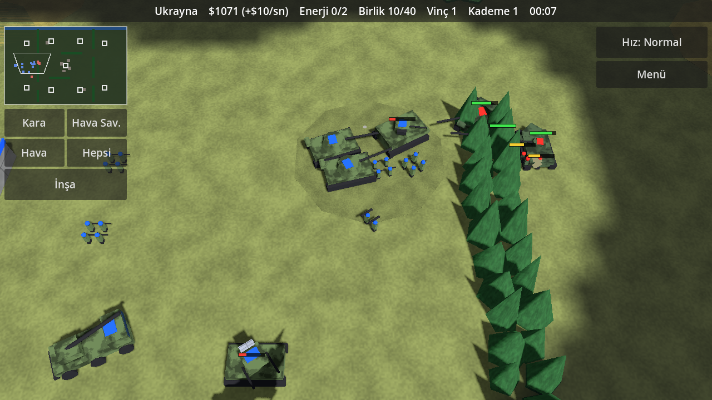
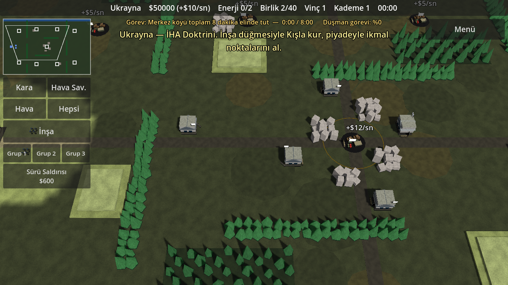
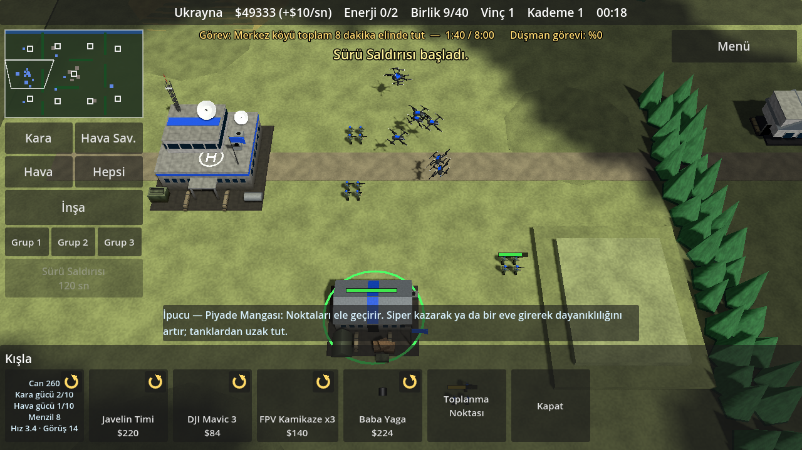
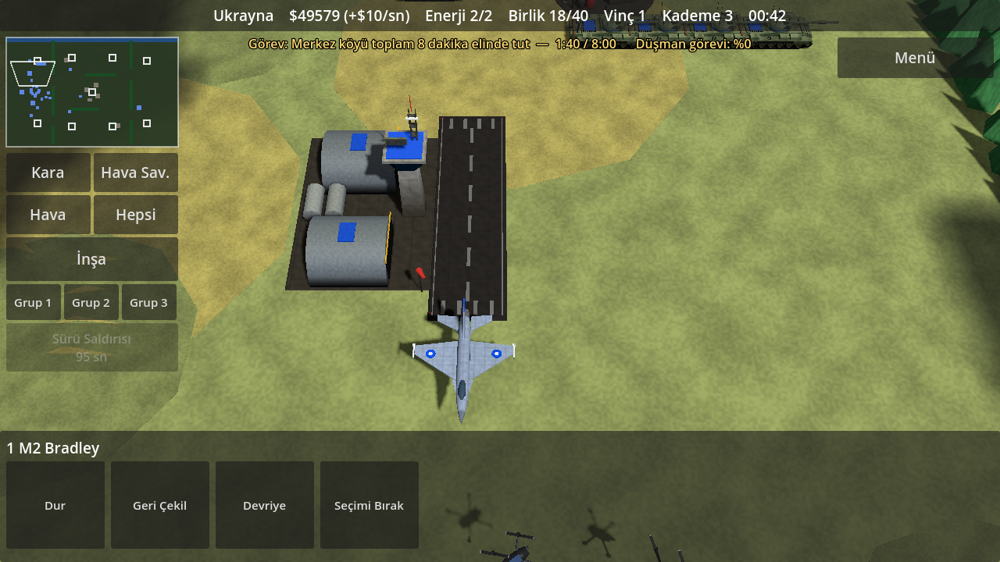
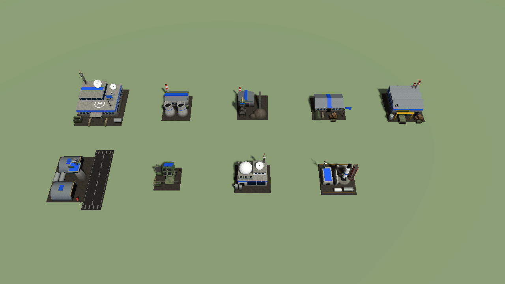

# Generals Game (çalışma adı)

Android için gerçek zamanlı strateji oyunu prototipi. Günümüz silahları, gerçek adlar, low-poly 3D.
Motor: **Godot 4.3** (GDScript, Compatibility/GLES3 işleyici).

Tasarım dokümanı: [docs/TASARIM.md](docs/TASARIM.md) (hedef ve yol haritası)













## Şu an oynanabilen

**Senaryolar.** Açılışta senaryo ve taraf seçilir; her senaryoda iki tarafı da oynayabilirsin.

| Senaryo | Taraflar ve doktrinleri | Harita |
|---|---|---|
| Rusya – Ukrayna | Ukrayna (İHA) / Rusya (Zırhlı-Topçu) | Harkiv açıkları: tarlalar, ağaç hatları, yıkık köy |
| İran – İsrail | İsrail (Hava Üstünlüğü) / İran (Balistik Füze) | Körfez: çöl, dağ sıraları, güneyde deniz |
| Pakistan – Hindistan | Pakistan (Balistik Füze) / Hindistan (Dengeli) | Sınır hattı: dağlık kuzey, nehir ve köprüler |
| Çin – ABD (2 senaryo), Türkiye – Yunanistan | kilitli | deniz moduyla açılacak |

**Ülkeler kendi silahlarını kullanır** (her ülkede 16-18 birim). Örnekler: T-64BV, Leopard 2A6, T-90M, Merkava Mk 4,
Karrar, Al-Khalid, Arjun; F-16, Mirage 2000, Su-35, Su-34, Su-57, F-35I, F-15I, F-14A, MiG-29, JF-17, J-10C, Rafale,
Su-30MKI, Tejas; Bayraktar TB2, Akıncı, Shahed-136, Geran-2, Lancet-3, Harop, Mohajer-6, MQ-9B; HIMARS, TOS-1A,
Pinaka; Patriot, S-400, Iron Dome, Bavar-373.

**Birim sınıfları**
- Kara: piyade, tanksavar timi, hafif zırhlı araç, tank, obüs, çok namlulu roketatar, hareketli hava savunma.
- Küçük İHA (kışladan, elden atılır): keşif dronu, FPV kamikaze (3'lü paket, uçuş süresi sınırlı), bombardıman dronu, dolanan mühimmat.
- Büyük İHA (hava alanı gerekir): keşif, silahlı, ağır silahlı, uzun menzilli kamikaze.
- Uçak (hava alanı gerekir, alan başına 4 pist): çok amaçlı, taarruz, görünmez. Görünmez uçağı hava savunma ancak yakından görür.

**Binalar:** Karargâh, Santral, Maden Ocağı (para), Kışla, Fabrika, Hava Alanı, hava savunma (ülkeye göre adı değişir),
Teknoloji Merkezi (6 araştırma, Kademe 3 için şart), Füze Üssü.

**Füzeler:** Füze Üssü'nden füze seçilir, haritada **görebildiğin** bir yere dokunulur. Menzildeki düşman hava savunması
füzeyi önleyebilir; hipersonik füzeler (Fattah-2, BrahMos, Fatah-IV) önlenemez.

**Doktrinler** maliyet ve dayanıklılığı değiştirir: örneğin İHA doktrininde dronlar ucuz, uçaklar pahalıdır; Balistik Füze
doktrininde füzeler ucuzdur ve Füze Üssü bir kademe erken açılır.

**Deneysel silahlar (Kademe 3):** Tryzub ve Iron Beam lazerleri (drone katili), S-70 Okhotnik-B, Ghatak, Su-57, F-35I, hipersonik füzeler.

**Animasyonlar:** tank ve zırhlıların kulesi gövdeden bağımsız hedefe döner; ateşte geri tepme, namlu alevi ve duman;
araçların arkasında toz; piyade yürürken adım atar, ateş ederken çömelir; füzeler duman izi bırakır; vurulan uçak
duman bırakarak düşer; yok edilen birimlerin yerinde yanık izi kalır.

**Taktik arazi:** tepede görüş (%30) ve menzil (%15) artar, tepedeki atıcı ağaç ve yıkıntıların üstünden görür;
ormanda piyade gizlenir (yalnızca 9 birimden yakından görülür) ve araçlar yavaşlar; yolda hız artar.
Dağ, ağaç hattı, yıkıntı ve binalar doğrudan atışı keser; topçu ve hava etkilenmez.

**Elektronik harp:** her ülkenin EH aracı (Bukovel-AD, Silok, Drone Dome, Kobra V8, D4) çevresindeki küçük dronları
düşürür, büyük İHA'ların kilidini bozar. "Fiber Optik FPV" araştırmasıyla FPV'ler etkilenmez.

**Siper ve mevzi:** piyade siper kazar (yarı hasar), köy evlerine girer (%60 az hasar, daha uzun menzil),
tanksavar mayını döşer (araçlar tetikler, düşman yalnızca yakından görür) ve tanksavar engeli kurar (yolu kapatır).

**Tecrübe ve geri çekilme:** hasar veren birimler rütbe kazanır (Er → Çavuş → Kıdemli → Gazi; her rütbe daha çok hasar,
daha az kayıp). Geri çekilen birlik %25 hızlı gider ve %30 az hasar alır; karargâh yanında onarılır.

**Doktrin yetenekleri:** Sürü Saldırısı (İHA), Havada Yakıt İkmali (Hava Üstünlüğü), Topçu Barajı (Zırhlı/Topçu),
Doyurma Salvosu (Balistik Füze), Seferberlik (Dengeli).

**Görev hedefleri:** karargâhı yıkmanın yanında her tarafın kendi görevi var: Rusya – Ukrayna'da merkez köyü 8 dakika
tutmak; İsrail'in 4 stratejik hedefi yok etmesi, İran'ın petrol terminalini tutması; Pakistan'ın 3 üretim tesisini yıkması,
Hindistan'ın orta geçidi tutması. Ekranın üstünde senin ve düşmanın ilerlemesi görünür.

**Birim kartları:** üretim düğmesinin köşesindeki çevirme simgesine basınca kart arkaya döner; can, kara gücü,
hava gücü, menzil ve hız görünür, ekranın altında o birimin kullanım ipucu çıkar.

**Yapay zekâ:** üç zorluk (Kolay, Orta, Zor) gelirini, ilk saldırı zamanını ve davranışını değiştirir. Orta ve Zor'da
düzenli keşif yapar, en zayıf savunulan hedefi seçer, uçaklarla önce hava savunmasını vurur ve İHA'larını o susana kadar
geride tutar; her zorlukta yaralı birliklerini ve çöken dalgaları geri çeker. Ordusunu doktrinine göre kurar
(Ukrayna baştan drone ağırlıklı, Rusya topçu ağırlıklı, İsrail uçak ağırlıklı, Hindistan piyade ağırlıklı).

**Arayüz:** eğitim bölümü (10 adım); üretim binalarına toplanma
noktası (birlikler orada yayılarak durur); devriye emri; üç birlik grubu (basılı tut: kaydet, dokun: seç, iki kez: kamerayı
götür); otomatik kayıt (dakikada bir, menüye dönüşte ve uygulama arka plana geçince) ve menüde "Devam Et".

**Ses ve görsellik:** atış, top, topçu, füze, lazer, patlama, uyarı, nokta alma ve terfi sesleri ile arka plan müziği
kodla sentezlenir (ses dosyası yok); sesler kameraya uzaklığa göre kısılır. Uçaklar ve büyük İHA'lar pistten kalkar,
mühimmatı bitince piste iner, silahlanıp yeniden kalkar. Yok edilen araçlar yanmış enkaz, binalar moloz bırakır;
ağır hasarlı binalar tüter ve yanar.

**Ayarlar:** menüde ses, müzik, gölge, duman/toz efektleri ve texture'lar ayrı ayrı kapatılabilir (eski telefonlar için).

Ayrıca: arazi ve yol bulma, serbest bina yerleşimi, vinç, karargâh yanında onarım, savaş sisi.

Henüz yok: deniz modu ve kilitli senaryolar, ses, zorluk seçimi, engebeli arazide görüş avantajı.

## Kontroller

| Hareket | Sonuç |
|---|---|
| Dokun | Birim / bina seç. Birim seçiliyken: yere dokun = saldırarak ilerle, düşmana dokun = saldır. Hava aracında: o bölgede devriye |
| Çift dokun | Ekrandaki aynı tip birimlerin hepsini seç |
| Sürükle | Kamerayı kaydır |
| Basılı tut + sürükle | Kutu seçimi |
| İki parmak | Yakınlaştır / uzaklaştır (bilgisayarda fare tekerleği) |
| Küçük harita | Dokunduğun yere kamerayı götürür |
| Kara / Hava Sav. / Hava / Hepsi | O gruptaki bütün birimleri seçer |
| İnşa | Bina menüsünü açar; bina seç, sonra haritada yerini göster. Vinç ve Kademe de burada |
| Geri Çekil | Seçili birimler ateş etmeden üsse döner |

## Çalıştırma

1. [Godot 4.3](https://godotengine.org/download/archive/4.3-stable/) indir.
2. Godot'u aç, **Import** ile bu klasördeki `project.godot` dosyasını seç.
3. **F5** ile oyna. Fare dokunmatik gibi çalışır.

### Android APK

Godot'ta **Editor → Manage Export Templates** ile şablonları indir, **Editor Settings → Export → Android**
altında Android SDK ve Java yolunu göster, sonra **Project → Export → Android → Export Project**.
Dışa aktarma ayarı (`export_presets.cfg`) repoda hazırdır.

## Dosya düzeni

| Yol | İçerik |
|---|---|
| `scripts/scenarios.gd` | **Oyunun verisi**: birim sınıfları, ülkeler ve envanterleri, doktrinler, araştırmalar, haritalar, senaryolar. Denge buradan ayarlanır |
| `scripts/defs.gd` | Genel sabitler (başlangıç parası, kademe bedelleri, yapay zekâ zorluğu) |
| `scripts/game.gd` | Maç döngüsü, ekonomi, inşa, araştırma, füzeler, seçim, emirler, efektler |
| `scripts/unit.gd`, `air_unit.gd`, `building.gd`, `entity.gd`, `shot.gd` | Kara birimi, hava aracı, bina, ortak taban, mermi |
| `scripts/models.gd` | Model girişi: bütün birim ve binaları ilgili dosyadan önbellekli olarak kurar; basit kutu/silindir yardımcıları |
| `scripts/tanks.gd` | Ayrıntılı tank modelleri (T-72B3, T-90M, Leopard 2A6, Merkava Mk 4): gerçek ölçülerle yürüyen aksam, kule, reaktif zırh, takım rengi tanıma örtüsü |
| `scripts/vehicles.gd` | Diğer kara araçları ve piyade: BMP, M113 türevleri, Bradley, Namer, Gepard, Shilka, Tor, obüsler, TOS-1A, kamyonlu sistemler (Pantsir, Iron Dome, HIMARS, roketatarlar, lazer) |
| `scripts/buildings.gd` | Bina modelleri, hava savunma bataryaları, vinç ve ikmal noktaları: beton ve oluklu sac dokular, pencereler, bacalar, antenler, bayrak ve çatı şeridiyle takım rengi |
| `scripts/aircraft.gd` | Ayrıntılı uçak ve İHA modelleri: jetler `AIRFRAMES` tablosundan (gövde istasyonları, hava alığı, nasel, kokpit camı, füze/bomba, milli işaret), İHA'lar gerçek ölçüyle; dönen pervaneler |
| `scripts/kit.gd` | Araç mesh kurucusu: parçaları malzeme başına tek yüzeyde birleştirir, çamur/toz/gölgeyi köşe rengine işler |
| `scripts/tex.gd` | Kodla üretilen texture'lar (arazi, su, kaya, kamuflaj, panel, boyalı zırh, metal, palet, branda, uçak boyası, beton, oluklu sac) |
| `scripts/terrain.gd` | Arazi ve yol bulma |
| `scripts/fog.gd` | Savaş sisi |
| `scripts/controls.gd`, `camera_rig.gd` | Dokunmatik kontroller ve kamera |
| `scripts/hud.gd`, `menu.gd` | Oyun içi arayüz ve senaryo seçim ekranı |
| `scripts/ai.gd` | Yapay zekâ rakip |
| `tools/` | Geliştirme testleri |

## Testler

```bash
godot --headless --path . --import
```

```bash
godot --headless --path . --fixed-fps 30 -- --autotest --scn=0 --side=0
```

```bash
godot --path . -- --inputtest --scn=2
```

```bash
godot --path . -- --gallery --scn=0 --shots=KLASÖR
```

- `--autotest`: oyuncu yerine bir bot oynar; her binayı kurar, her birimi üretir, araştırma yapar, füze atar ve saldırır.
  `--scn` senaryoyu (0-2), `--side` tarafı (0-1) seçer. Ekran görüntüsü için `--headless` olmadan `--shots=KLASÖR` ekle.
- `--inputtest`: dokunma hareketlerini taklit edip kontrolleri ve kuralları doğrular; gerçek pencere ister.
- `--gallery`: senaryodaki bütün modelleri yan yana dizip görüntüsünü alır.
- `--mechtest --scn=0`: oynanış mekaniklerini tek tek doğrular (arazi, EH, siper, ev, mayın, engel, rütbe, görev, yetenek, kart).
- `--load --loadtest`: `--mechtest`'in kaydettiği oyunu yükler ve durumun geri geldiğini doğrular.
- `--tutorial --tuttest`: eğitimi baştan sona oynar.
- `--diff=N`: yapay zekâ zorluğu (0 Kolay, 1 Orta, 2 Zor); `--autotest` ile birlikte kullanılabilir.
- `--duel --scn=0`: denge için aynı bütçeyle sınıf düelloları yapar ve kalan değerleri yazar.
- `--animtest`: iki küçük grubu çarpıştırır; hareket, kule dönüşü ve geri tepmeyi doğrular (`--shots=KLASÖR` ile görüntü alır).
