# Generals Game (çalışma adı)

Android için gerçek zamanlı strateji oyunu prototipi. Günümüz silahları, gerçek adlar, low-poly 3D.
Motor: **Godot 4.3** (GDScript, Compatibility/GLES3 işleyici).

Tasarım dokümanı: [docs/TASARIM.md](docs/TASARIM.md) (hedef ve yol haritası)

Logo ve menüdeki oyun adı ("CEPHE HATTI") bir öneridir; `scripts/logo.gd` içindeki `TITLE` sabitinden değiştirilir.

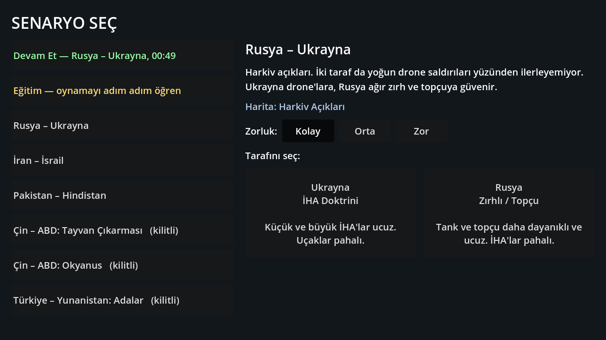

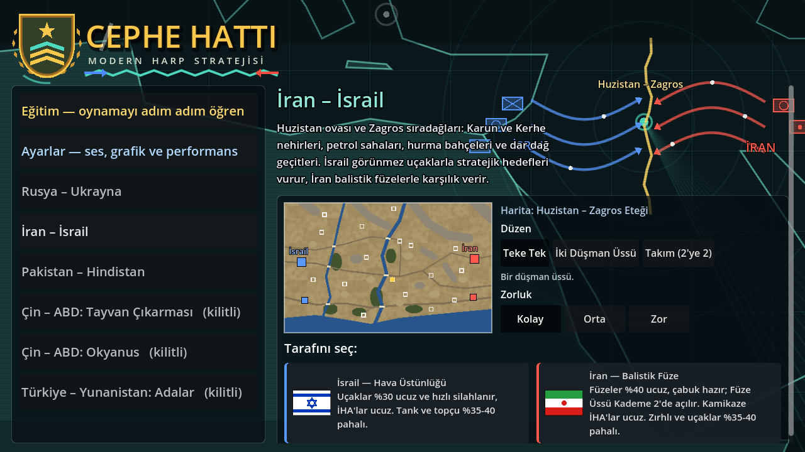

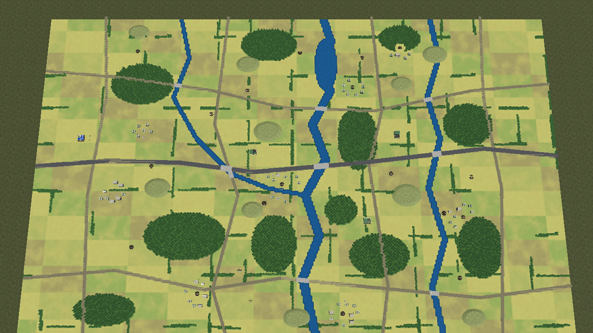

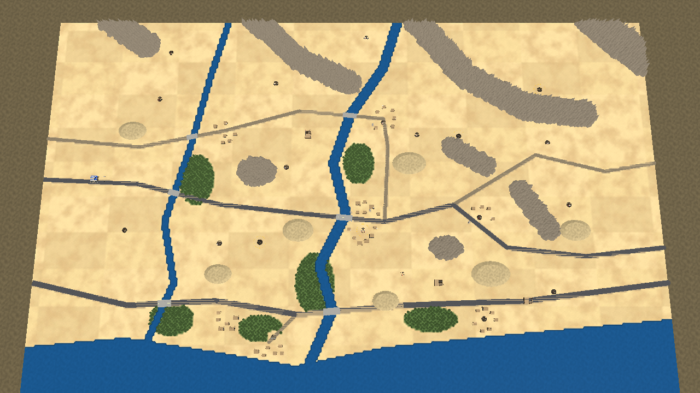

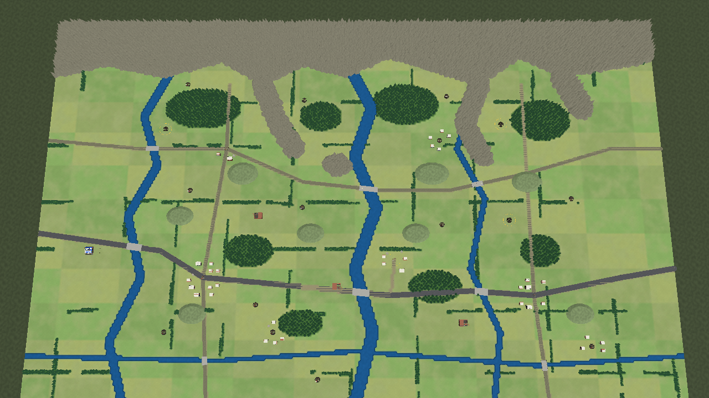

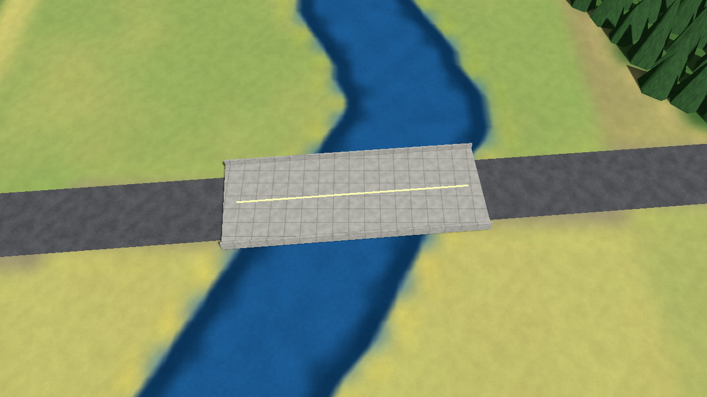

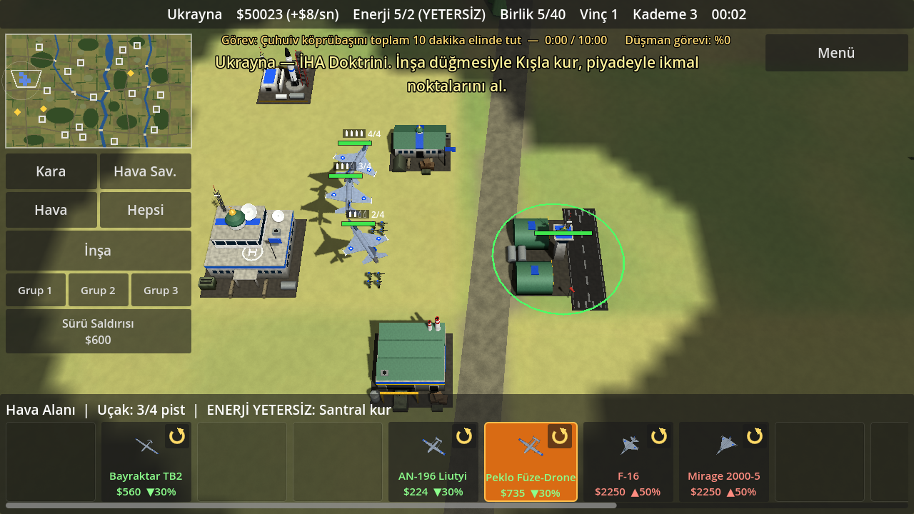

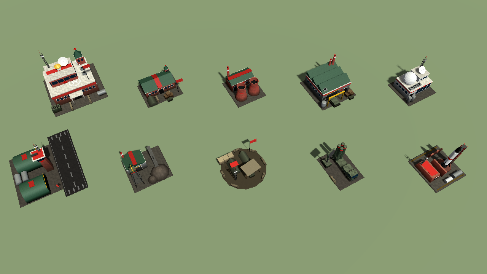

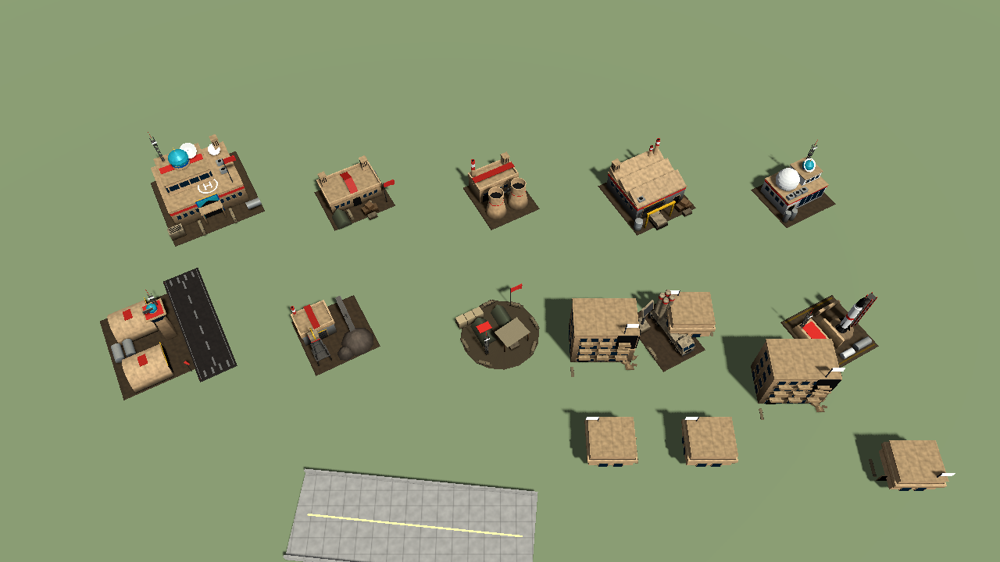

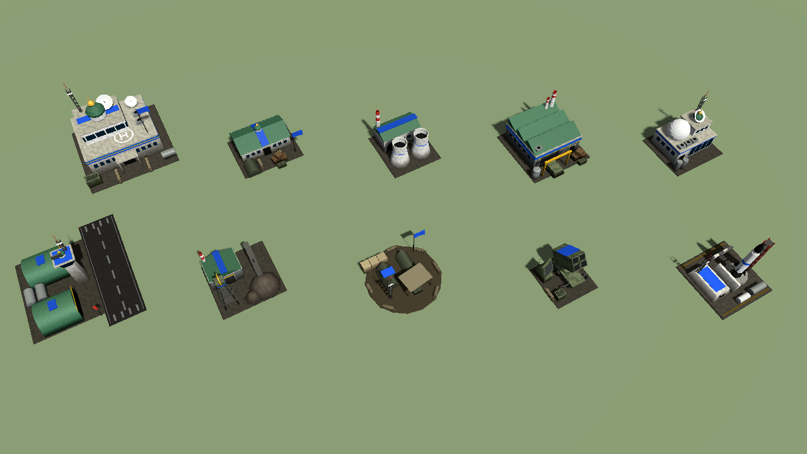

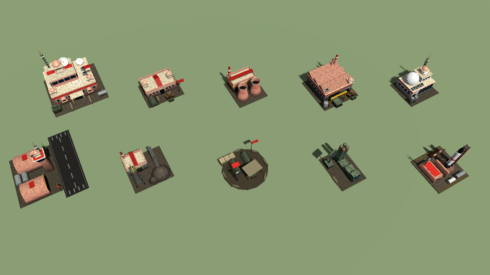

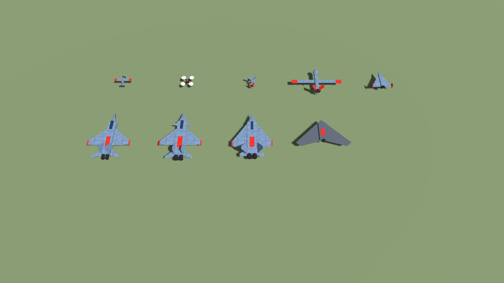

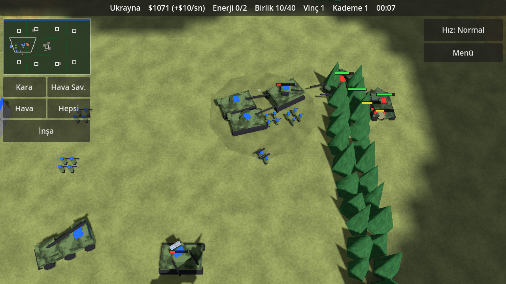

## Şu an oynanabilen

**Senaryolar.** Açılışta senaryo, taraf, zorluk ve maç düzeni seçilir; her senaryoda iki tarafı da oynayabilirsin.
Menünün arkasında taktik bir dünya haritası vardır: senaryo seçilince harita o bölgeye yaklaşır, renk teması değişir,
iki tarafın birlik simgeleri ve cephe okları çizilir; yanda savaş alanının gerçek önizlemesi görünür.

| Senaryo | Taraflar ve doktrinleri | Harita (612 x 374) |
|---|---|---|
| Rusya – Ukrayna | Ukrayna (İHA) / Rusya (Zırhlı-Topçu) | Harkiv – Severski Donets: Donets, Oskil ve Udy nehirleri, Peçenihi barajı, köprüler, geniş ormanlar, ağaç hatlarıyla bölünmüş tarlalar, Çuhuiv, Kupiansk, İzyum, Vovçansk |
| İran – İsrail | İsrail (Hava Üstünlüğü) / İran (Balistik Füze) | Huzistan – Zagros: Karun ve Kerhe nehirleri, Basra Körfezi kıyısı, Zagros sıradağları ve geçitleri, hurma bahçeleri, Ahvaz ve Abadan petrol tesisleri |
| Pakistan – Hindistan | Pakistan (Balistik Füze) / Hindistan (Dengeli) | Keşmir – Kontrol Hattı: Himalaya etekleri, çam ormanları, hâkim tepeler, Chenab, Jhelum ve Tawi nehirleri, Pencap kanalları |
| Çin – ABD (2 senaryo), Türkiye – Yunanistan | kilitli | deniz moduyla açılacak |

**Maç düzeni:** Teke Tek; İki Düşman Üssü (düşmanın iki ayrı üssü ve ordusu); Takım 2'ye 2 (yanında müttefik bir yapay
zekâ ordusu, karşında iki düşman üssü). Aynı taraftakiler görüşü ve görevi paylaşır. Düşman tarafının bütün
karargâhları yıkılınca ya da görev tamamlanınca maç biter.

**Görev seçimi (menüden):** *Senaryo Görevi* (her ülkenin kendi görevi), *Bölgeyi Tut* (iki taraf da haritanın
ortasındaki kilit noktayı kesintisiz 10 dakika tutmaya çalışır; nokta elden çıkarsa sayaç baştan başlar) ya da *Tam İmha* (düşmanın bütün binalarını ve birliklerini
yok et; karargâh yıkılsa da savaş sürer, düşmanın binası kalmayınca kalan birlikleri küçük haritada gösterilir).
Maç bitince ekranda gerçek neden yazar (karargâhın yıkıldı, düşman görevini tamamladı, ordun tamamen yok edildi...).

**Büyük haritalar ve lojistik.** Haritalar ilk sürümün yaklaşık 7 katı alan kaplar (veride 720 x 440 yazılır, oyunda
%85'e küçültülür). Birlikler uzun yol yürür; yol bulma yolları
tercih eder (yolda %50 hızlı). **İkmal hattı:** karargâh (75), İleri Harekât Üssü (55) ve sağlam ikmal noktaları (62)
çevresine ikmal sağlar. Hattın dışındaki kara birliği %30 az hasar verir, %10 yavaş gider ve onarılmaz (üstünde turuncu
işaret çıkar). İleri Harekât Üssü birliklerinin yanında her yere kurulur, birlikleri onarır ve çevresine kışla, santral
ve hava savunma kurulabilir.

**İnşa alanı (sarı alan):** karargâhın çevresi ve her üs binasının çevresi; alanın kenarına kurduğun her bina alanı
büyütür. Alan tek parça sarı olarak çizilir, içi ve ileri üslerin çevresi savaş sisiyle örtülmez.

**Taktik arazi.** Köprüler yıkılabilir (topçu, füze, uçak ya da "Köprü Yık" emri; köprünün yeri bilinir, görmeden de
vurulur, hasarlıyken canı üstünde yazar); yıkılan köprünün üstündekiler suya düşer, nehir orada geçilmez olur. Araçlar
köprünün tabliyesinin üstünden geçer. Yıkık köprü, son 30 saniyede vurulmadıysa ve yanında yalnızca bir tarafın askerî
birlikleri varsa 40 saniyede onarılır. Tepeyi tutmak: görüş %30, menzil %15 ve hasar %15 artar; tepedeki atıcı ağaçların ve yıkıntıların üstünden
görür. Geniş ormanlar ve ağaç hatları piyadeyi her zaman, aracı dururken gizler (yalnızca yakından görülür), derin orman
görüşü keser. Kasabalarda köy evleri (2 birlik), yıkık apartmanlar (3 birlik, üst kattan uzağı görür) ve terk edilmiş
fabrikalar (4 birlik) vardır.

**Kaynaklar.** Gelir çok düşüktür: karargâh $8/sn, ikmal noktası $2, kasaba $3, petrol/gaz $4-6. Maç boyunca haritanın
rastgele yerlerinde **kaynak yatakları** belirir ve herkese duyurulur (küçük haritada yanıp söner). Yatağın üstüne
Maden Ocağı ilk kuran takımın olur ($4-6,5/sn; kurulumu $1600, yanında kendi birliğin olmalı); yatağın rezervi bitince
tükenir. **Bütün kaynaklar tahrip edilebilir:** ikmal noktaları ve madenler hasar aldıkça daha az gelir getirir, sıfıra
inen nokta kimsesiz kalır ve 90 saniye **tahrip** durumda kalır (gelir yok, ele geçirilemez); yıkılan madenin yatağına da
90 saniye yeni maden kurulamaz. Vurulan kaynak 20 saniye onarılamaz; sonra onarım yalnızca yanında kendi tarafının askerî
birliği varken ve çevrede düşman yokken ilerler. Kaynakların (ikmal noktaları ve madenler) yeri herkesçe bilinir: birlikler,
topçu ve füzeler onları görmeden de vurabilir. Maden Ocağı elinde kaldıkça verimi artar (10 dakikada en çok %20).
Başta 3 yatak belirir, sonra her 120-200 saniyede yenisi gelir (aynı anda en çok 6); rezervleri (bir yatağın toplam vereceği para) $9000-15000'dir.

**Doktrinler** fiyatı belirler: doktrine uyan birimler %25-40 ucuz, uymayanlar %20-60 pahalıdır (kartta yeşil ▼ ya da
kırmızı ▲). Bazı ülkelerde bazı birimler hiç yoktur: Ukrayna'nın tankı yoktur (İHA'larla Rus zırhını avlar), İsrail'in
çok namlulu roketatarı yoktur. Her ülkede uzun menzilli topçu/roketatardan yalnızca bir tane vardır (Zırhlı/Topçu
doktrinli Rusya'da iki), dron savar hava savunmadan bir tane, uçaklardan da her türden (çok amaçlı, taarruz, görünmez)
en çok bir tane. Üretim panelinde birimler sabit yuvalara dizilir; ülkede olmayan
birimin yuvası boş kalır, diğerleri kaymaz.

**Deneysel silahlar (Kademe 3)** turuncu kartla gösterilir; %50 pahalı, %50 daha çok hasar ve %30 daha çok can:
T-14 Armata, Merkava Barak, Su-57, S-70, F-35I, J-35, Ghatak, Peklo füze-drone, Shahed-238, hipersonik füzeler.

**Ulusal mimari.** Her ülkenin binaları kendi üslubundadır: Ukrayna'da badanalı duvar, yeşil çatı ve altın armut kubbe;
Rusya'da kızıl tuğla, çadır çatılı kule, soğan kubbe ve kızıl yıldız; İsrail'de Kudüs taşı, kemerli revak ve çatıda güneş
enerjili su ısıtıcıları; İran'da kerpiç, turkuaz kubbe, rüzgâr kuleleri (badgir) ve çinili eyvan; Pakistan'da kızıl kumtaşı,
beyaz mermer Babür kubbesi ve çhatriler; Hindistan'da pembe kumtaşı, çhatriler ve cumbalı pencereler. Köy evleri
haritanın üslubunu alır.

**Hava araçlarının mühimmatı:** her silahlı uçak ve İHA'nın üstünde dolu ve boş füzeleri simge olarak görünür
(dost birimlerde "3/4" sayısı da yazar); silahlanırken "silahlanıyor" yazar.

**Ülkeler kendi silahlarını kullanır** (her ülkede 16-19 birim). Örnekler: T-72B3, T-90M, T-14 Armata, Merkava Mk 4,
Karrar, Al-Khalid, Arjun; F-16, Su-24M, Su-35, Su-34, Su-57, F-35I, F-15I, F-14A, JF-17, J-10C, Rafale, Su-30MKI;
Bayraktar TB2, Akıncı, Shahed-136, Geran-2, Lancet-3, Harop, Mohajer-6, MQ-9B; HIMARS, Tornado-S, Pinaka; Buk-M1/M3,
Machbet, Herz-9, HQ-16FE, Akash; Patriot, S-400, Iron Dome, Bavar-373.

**Birim sınıfları**
- Kara: piyade, tanksavar timi, hafif zırhlı araç, tank, obüs, çok namlulu roketatar, dron savar hava savunma,
  zırhlı hava savunma (Kademe 2: uçakları ve büyük İHA'ları uzaktan sert vurur, yerdeki hedeflere neredeyse etkisiz).
- Keşif ve silahlı İHA'ların görüşü geniştir (kamikazeler hariç). Araç modelleri okunur olsun diye büyüktür.
- Küçük İHA (kışladan, elden atılır): keşif dronu, FPV kamikaze (3'lü paket, uçuş süresi sınırlı), bombardıman dronu, dolanan mühimmat.
- Büyük İHA (hava alanı gerekir): keşif, silahlı, ağır silahlı, uzun menzilli kamikaze.
- Uçak (hava alanı gerekir, alan başına 4 pist): çok amaçlı, taarruz, görünmez. Görünmez uçağı hava savunma ancak yakından görür.

**Binalar:** Karargâh, Santral, Kışla, Fabrika, Maden Ocağı (yalnızca kaynak yatağına), İleri Harekât Üssü, Hava Alanı,
hava savunma (ülkeye göre adı değişir), Teknoloji Merkezi (7 araştırma, Kademe 3 için şart), Füze Üssü.

**Füzeler:** Füze Üssü'nden füze seçilir, haritada **görebildiğin** bir yere (ya da yeri bilinen bir düşman kaynağına,
stratejik tesise) dokunulur. **Balistik füzelerin canı vardır:** uçuşun ikinci yarısında menzildeki düşman hava
savunmaları (bina, zırhlı hava savunma, dron savar, lazer) silahları hazır oldukça önleyici atar ve füzenin canını düşürür;
canı biten füze havada patlar, hasarlı füze daha az hasar verir. Hipersonik füzeler (Fattah-2, BrahMos, Fatah-IV) çok
daha dayanıklıdır, ancak son anda ve zor vurulur. Yapay zekâ iki füze arasında en az 200/140/100 saniye bekler
(Kolay/Orta/Zor) ve ilk füzesini 4. dakikadan önce atmaz.

**Hava savunması yeri de vurur:** hava savunma binası, zırhlı hava savunma, dron savar ve lazer yerdeki piyadeyi ve hafif
araçları vurur (tanka zayıf); böylece üssü savunur. Menzile bir uçak, İHA ya da dron girince yer hedefini bırakıp ona
döner; dron savar taretleri hızlı döner. Küçük dronlar: dron savar bir FPV'yi iki atışta, lazer tek atışta düşürür;
elektronik harp aracı 16 birim içindeki küçük dronları bir saniyede düşürür (Fiber Optik FPV hariç).

**Dosta yardım:** bir dosta (birlik ya da bina) saldırı olunca 26 birim içindeki boştaki silahlı dost birlikler
saldırgana yönelir; emir almış (yürüyen) birlik emrini bozmaz. **Ateş edemeyen birlik ilerlemez:** saldırı emrinde
hedefi vuramayan birlik (dron savar, EH aracı...) yerinde kalır. **Yıkık köprüden geçilmez:** köprü yıkılınca yolu o
köprüden geçen birlikler yolu yeniden hesaplar; suya giremez.

**İnşaat iptali:** inşaat hâlindeki bina seçilince "İnşaatı İptal Et" düğmesi çıkar; parası tamamen geri gelir.
**Uçaklar pistte onarılır:** inen uçak silahlanırken canı da dolar (küçük dronlar kışlanın üstünde bekler ve onarılır).

**Animasyonlar:** tank ve zırhlıların kulesi gövdeden bağımsız döner: hedefi yaklaşırken de, yürürken de izler, boşta
ağır ağır çevreyi gözler; ateşte geri tepme, namlu alevi ve duman; araçların arkasında toz. Piyade askerleri kalça ve
dizden bükülen bacaklarla adım atar (adım hıza göre, ayak kaymaz), öne eğik yürür, geri çekilirken koşar; çatışmada diz
çöker, sırayla tetik çeker; boşta etrafa bakınır. Vurulan asker yere yığılır, bir süre yatıp kaybolur; onarılan mangaya
geri döner. Füzeler duman izi bırakır; vurulan uçak duman bırakarak düşer; yok edilen birimlerin yerinde yanık izi kalır.

**Emir önceliği:** yere dokununca birlik emredilen yere sapmadan gider; yolda menzile giren düşmana durmadan ateş eder
(topçu hariç). Boştaki birlik görüş alanına giren her düşmana kendiliğinden saldırır (topçu menzilindekine) ama bulunduğu
yerden 24 birimden fazla uzaklaşmaz, sonra yerine döner. Düşmana dokunmak doğrudan saldırı emridir.

**Kamikaze dronlar** (FPV, dolanan mühimmat, kamikaze İHA) gönderildikleri bölgenin yakınında tarafının gördüğü bir düşman
belirince beklemeden ona dalar; kilitlendikten sonra hedef bölgeden çıksa da kovalar.

**Ölçek:** askerler, araçlar ve ağaçlar birbirine göre gerçek oranlardadır (ağaç askerin 6-9 katı); kamera açılışta
yakından bakar, iki parmakla uzaklaşınca bütün cephe görülür.

**Harita görüntüsü:** arazi bir yükseklik alanıdır: yuvarlak tepeler, sırtlı kayalık dağlar, kumsallı nehir yatağı,
tarla parselleri ve harita dışında ufka uzanan tepeler. Su dalgalanır, kıyıya köpük vurur; ağaçlar (kavak, çam,
yapraklı, hurma), çalılar, ot öbekleri ve sazlar rüzgârda salınır; kuş sürüleri haritanın üstünden geçer, yırtıcılar
tepelerin üstünde süzülür; bulut gölgeleri araziyi yavaşça geçer. Savaş sisi araziye oturur ve bitkileri de karartır.
Hepsi kodla üretilir. Ayarlardaki "Doğa ayrıntıları" kapatılınca ot, çalı, kuş, rüzgâr ve bulut gölgesi çizilmez
(eski telefonlar için).

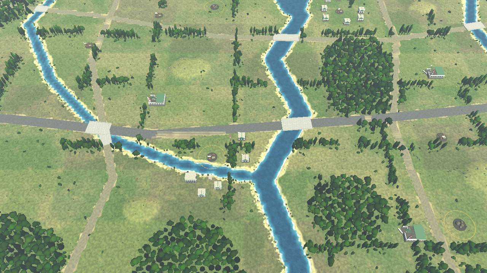

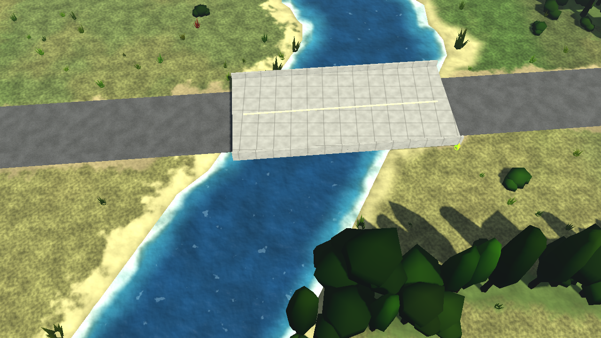

**Elektronik harp:** her ülkenin EH aracı (Bukovel-AD, Silok, Drone Dome, Kobra V8, D4) çevresindeki küçük dronları
düşürür, büyük İHA'ların kilidini bozar. "Fiber Optik FPV" araştırmasıyla FPV'ler etkilenmez.

**Siper ve mevzi:** piyade siper kazar (yarı hasar), köy evlerine girer (%60 az hasar, daha uzun menzil),
tanksavar mayını döşer (araçlar tetikler, düşman yalnızca yakından görür) ve tanksavar engeli kurar (yolu kapatır).

**Tecrübe ve geri çekilme:** hasar veren birimler rütbe kazanır (Er → Çavuş → Kıdemli → Gazi; her rütbe daha çok hasar,
daha az kayıp). Geri çekilen birlik %25 hızlı gider ve %30 az hasar alır; karargâh yanında onarılır.

**Doktrin yetenekleri:** Sürü Saldırısı (İHA), Hava Akını (Hava Üstünlüğü: iki bombardıman uçağı üssünden kalkar, görülen
hedefe 12 bomba bırakıp döner; hava alanı gerekmez; hava savunması uçakları düşürebilir), Topçu Barajı (Zırhlı/Topçu),
Doyurma Salvosu (Balistik Füze), Seferberlik (Dengeli).

**Görev hedefleri:** karargâhı yıkmanın yanında her tarafın kendi görevi var: Rusya – Ukrayna'da Çuhuiv köprübaşını
kesintisiz 10 dakika tutmak; Pakistan'ın 3 üretim tesisini (kışla, fabrika, hava alanı) yıkması, Hindistan'ın Akhnur
köprübaşını tutması. Pakistan'ın hedefleri Hindistan üssünün dibinde değil, cephenin yakınındaki ileri hatta hazır kuruludur;
haritada kırmızı nişangâhla işaretlidir ve çevrelerinde bağımsız savunucular vardır (düşmanın kendi kurduğu binalar sayılmaz).
İran – İsrail'de iki tarafın görevi aynıdır: **4 bölgeyi ele geçirmek** (Kerhe Tepesi, Karun Sırtı, Şuş Sanayi Bölgesi,
Mahşehr Depoları) ve dördünü birlikte kesintisiz 1,5 dakika tutmak. Bölgeleri baştan **bağımsız kuvvetler** tutar (siper
kazmış piyade, tanksavar, dron savar, zırhlı ve tank; kum sarısı renkte). Gelen her iki orduya da saldırırlar, yerlerinden
ayrılmazlar. Bir bölgenin bağımsız kuvvetleri tükenince yaklaşık 2 dakika sonra orada daha zayıf bir grup (2 piyade,
tanksavar, bazen zırhlı; %60 can) yeniden belirir ve bölgeyi kim tutuyorsa onunla çarpışır. Bölge, alanda yalnızca bir
ordunun kara birliği kalınca 20 saniyede o tarafın olur; sahibi yokken alanı bağımsızlar tutarsa yeniden tarafsızlaşır.
Bölgeler küçük haritada halka olarak görünür (sahibinin renginde; alınırken dolan yay). Bütün tutma
sürelerinde sayaç kesintisizdir: nokta ya da bölgelerden biri elden çıkınca sayaç sıfırlanır. Ekranın üstünde senin ve düşmanın
ilerlemesi görünür.

**Saldırı uyarısı:** kendi binan ya da kaynağın vurulunca küçük haritada o yer kırmızı yanıp söner, binanın üstünde
"SALDIRI!" yazar. **Araştırmalar** ne işe yaradıklarını düğmenin üstünde yazar.

**Birim kartları:** üretim düğmesinin köşesindeki çevirme simgesine basınca kart arkaya döner; can, kara gücü,
hava gücü, menzil ve hız görünür, ekranın altında o birimin kullanım ipucu çıkar.

**Yapay zekâ:** her bilgisayar takımı (düşman ya da müttefik) için ayrı çalışır. Üç zorluk (Kolay, Orta, Zor) gelirini,
düşünme sıklığını, ilk saldırı zamanını ve davranışını değiştirir. Kaynak yataklarına korumalı maden kurar, madenlerine
bekçi bırakır, hasarlı kaynaklarının yanına onarım için birlik gönderir; toplanma yeri ikmal dışındaysa İleri Harekât Üssü
kurar. Ordusunu doktrinine göre kurar (ucuz sınıfları çok alır) ve gördüğüne karşılık verir: uçaklara hava savunma, zırha
tanksavar ve İHA, dron sürüsüne EH ve dron savar; deneysel silah kullanır. Orta ve Zor'da düşman madenlerine ve noktalarına
baskın yapar, en zayıf savunulan hedefi seçer, odaklı ateşle en zayıf düşmanı birlikte vurur, uçaklarla önce hava
savunmasını susturur. Karşı taraf tutma görevini bitirmek üzereyse bütün ordusuyla o noktaya yürür. Yaralı birliklerini
ve çöken dalgaları geri çeker.

**Arayüz:** eğitim bölümü (10 adım); üretim binalarına toplanma
noktası (birlikler orada yayılarak durur); devriye emri; üç birlik grubu (basılı tut: kaydet, dokun: seç, iki kez: kamerayı
götür); otomatik kayıt (dakikada bir, menüye dönüşte ve uygulama arka plana geçince) ve menüde "Devam Et".

**Ses ve görsellik:** bütün sesler ve müzik kodla sentezlenir (ses dosyası yok). Sesler katmanlıdır (keskin çatırtı,
gümbürtü, uzayan kuyruk, açık arazi yankısı); her sesin üç çeşidi vardır; piyade tüfeği, araç topu, tank topu,
topçu, füze kükremesi, lazer, küçük ve büyük patlama (moloz çıtırtısıyla), uçak geçişi, dron vızıltısı, önleme,
inşaat bitti, uyarı sireni, nokta alma ve terfi fanfarı. Sesler kameraya uzaklığa göre kısılır ve pesleşir. Tiz
sesler yormasın diye efektler ~2,5 kHz, müzik ~3 kHz alçak geçiren süzgeçten geçer; uyarı, tık, nokta alma ve terfi tonları pestir. Giriş
ekranında marş havasında, maçta daha gergin bir müzik çalar (yaylılar, bas, davul, nefesli melodi); müzik ilk açılışta
üretilip telefona kaydedilir. Uçaklar ve büyük İHA'lar pistten kalkar,
mühimmatı bitince piste iner, silahlanıp yeniden kalkar. Yok edilen araçlar yanmış enkaz, binalar moloz bırakır;
ağır hasarlı binalar tüter ve yanar.

**Ayarlar:** menüde ses, müzik, gölge, duman/toz efektleri, texture'lar ve doğa ayrıntıları ayrı ayrı kapatılabilir
(eski telefonlar için). Arayüz telefonun güvenli alanının içinde kalır (kamera deliği / çentik); telefon bunu
bildirmiyorsa "Ekran kenarında ek boşluk" açılabilir. Menüde ve üretim çubuğunda parmakla kaydırma, düğmelerin
üstünden başlasa da çalışır (kaydırırken düğmeye basılmaz).

Ayrıca: arazi ve yol bulma, serbest bina yerleşimi, vinç, karargâh yanında onarım, savaş sisi.

Henüz yok: deniz modu ve kilitli senaryolar.

## Kontroller

| Hareket | Sonuç |
|---|---|
| Dokun | Birim / bina seç. Birim seçiliyken: yere dokun = oraya git (yolda ateş eder, sapmaz), düşmana dokun = saldır. Hava aracında: o bölgede devriye |
| Çift dokun | Ekrandaki aynı tip birimlerin hepsini seç |
| Sürükle | Kamerayı kaydır |
| Basılı tut + sürükle | Kutu seçimi |
| İki parmak | Yakınlaştır / uzaklaştır (bilgisayarda fare tekerleği) |
| Küçük harita | Dokunduğun yere kamerayı götürür |
| Kara / Hava Sav. / Hava / Hepsi | O gruptaki bütün birimleri seçer |
| İnşa | Bina menüsünü açar; bina seç, sonra haritada yerini göster. Vinç ve Kademe de burada |
| Geri Çekil | Seçili birimler ateş etmeden en yakın karargâha ya da ileri üsse döner |
| Köprü Yık | Seçili birimler dokunulan köprüye ateş eder |

## Çalıştırma

1. [Godot 4.3](https://godotengine.org/download/archive/4.3-stable/) indir.
2. Godot'u aç, **Import** ile bu klasördeki `project.godot` dosyasını seç.
3. **F5** ile oyna. Fare dokunmatik gibi çalışır.

### Android APK

Godot'ta **Editor → Manage Export Templates** ile şablonları indir, **Editor Settings → Export → Android**
altında Android SDK ve Java yolunu göster, sonra **Project → Export → Android → Export Project**.
Dışa aktarma ayarı (`export_presets.cfg`) repoda hazırdır.

## Dosya düzeni

| Yol | İçerik |
|---|---|
| `scripts/scenarios.gd` | **Oyunun verisi**: birim sınıfları, ülkeler ve envanterleri, doktrinler (fiyat çarpanları), araştırmalar, üretim yuvaları, haritalar (şekillerle), senaryolar. Denge buradan ayarlanır |
| `scripts/defs.gd` | Genel sabitler (başlangıç parası, gelir, kademe bedelleri, yapay zekâ zorluğu, maç düzenleri, lojistik ve kaynak yatağı ayarları), takım/taraf ilişkileri |
| `scripts/game.gd` | Maç döngüsü, ekonomi, inşa, araştırma, füzeler, seçim, emirler, efektler |
| `scripts/unit.gd`, `air_unit.gd`, `building.gd`, `entity.gd`, `shot.gd` | Kara birimi, hava aracı, bina, ortak taban, mermi |
| `scripts/models.gd` | Model girişi: bütün birim ve binaları ilgili dosyadan önbellekli olarak kurar; basit kutu/silindir yardımcıları |
| `scripts/tanks.gd` | Ayrıntılı tank modelleri (T-72B3, T-90M, Leopard 2A6, Merkava Mk 4): gerçek ölçülerle yürüyen aksam, kule, reaktif zırh, takım rengi tanıma örtüsü |
| `scripts/vehicles.gd` | Diğer kara araçları ve piyade: BMP, M113 türevleri, Bradley, Namer, Gepard, Shilka, Tor, obüsler, TOS-1A, kamyonlu sistemler (Pantsir, Iron Dome, HIMARS, roketatarlar, lazer) |
| `scripts/buildings.gd` | Bina modelleri, hava savunma bataryaları, vinç, ikmal noktaları, kaynak yatağı, ileri üs, apartman ve fabrika harabesi; ülkelere göre mimari üslup (renkler, çatı tipi, kubbe, kule, yıldız, güneş paneli, çhatri) |
| `scripts/aircraft.gd` | Ayrıntılı uçak ve İHA modelleri: jetler `AIRFRAMES` tablosundan (gövde istasyonları, hava alığı, nasel, kokpit camı, füze/bomba, milli işaret), İHA'lar gerçek ölçüyle; dönen pervaneler |
| `scripts/kit.gd` | Araç mesh kurucusu: parçaları malzeme başına tek yüzeyde birleştirir, çamur/toz/gölgeyi köşe rengine işler |
| `scripts/tex.gd` | Kodla üretilen texture'lar (arazi, su, kaya, kamuflaj, panel, boyalı zırh, metal, palet, branda, uçak boyası, beton, oluklu sac) |
| `scripts/terrain.gd` | Arazi: haritayı şekillerden kurar (nehir, yol, köprü, kasaba, tarla ağaç hatları), zemin resmi, yükseklik alanı ve arazi ağı, bitki örtüsü yerleşimi, yol bulma, görüş hattı |
| `scripts/bridge.gd`, `supply_point.gd`, `deposit.gd`, `garrison.gd` | Yıkılabilir köprü; tahrip edilebilir ikmal noktası; kaynak yatağı; girilebilen ev, apartman ve fabrika |
| `scripts/logo.gd`, `world_map.gd`, `map_preview.gd` | Logo ve amblem; menünün taktik dünya haritası ve bayraklar; senaryo harita önizlemesi |
| `scripts/scenery.gd` | Doğa görselleri: arazi, su, bitki ve kuş shader'ları; ağaç, çalı, ot, kaya ve kuş modelleri |
| `scripts/birds.gd` | Kuş sürüleri ve süzülen yırtıcılar |
| `scripts/region.gd` | Bölge: bağımsız kuvvetlerin tuttuğu, ele geçirilecek alan; yeniden doğan savunucular |
| `scripts/touch.gd` | Parmakla kaydırma (düğmelerin üstünden de) ve ekranın güvenli alanı (çentik / kamera deliği) |
| `scripts/fog.gd` | Savaş sisi (araziye oturur) ve bulut gölgeleri |
| `scripts/zone.gd` | İnşa alanı: karargâhın ve binaların çevresindeki dairelerin birleşimi tek sarı alan olarak çizilir |
| `scripts/controls.gd`, `camera_rig.gd` | Dokunmatik kontroller ve kamera |
| `scripts/hud.gd`, `menu.gd` | Oyun içi arayüz ve senaryo seçim ekranı |
| `scripts/ai.gd` | Yapay zekâ (düşman ve müttefik ordular) |
| `tools/` | Geliştirme testleri |

## Testler

```bash
godot --headless --path . --import
```

```bash
godot --headless --path . --fixed-fps 30 -- --autotest --scn=0 --side=0
```

```bash
godot --path . -- --inputtest --scn=2
```

```bash
godot --path . -- --gallery --scn=0 --shots=KLASÖR
```

- `--autotest`: oyuncu yerine bir bot oynar; her binayı kurar, her birimi üretir, kaynak yatağına maden ve ileri üs kurar,
  araştırma yapar, füze atar ve saldırır. `--scn` senaryoyu (0-2), `--side` tarafı (0-1), `--mode` maç düzenini
  (0 teke tek, 1 iki düşman üssü, 2 takım) seçer; `--idle` ile oyuncu hiçbir şey yapmaz (yapay zekânın temposunu ölçer).
  Ekran görüntüsü için `--headless` olmadan `--shots=KLASÖR` ekle.
- `--inputtest`: dokunma hareketlerini taklit edip kontrolleri ve kuralları doğrular; gerçek pencere ister.
- `--gallery`: senaryodaki bütün modelleri ve iki ülkenin binalarını yan yana dizip görüntüsünü alır (`--archonly`: yalnızca binalar).
- `--viewtest --scn=N --shots=KLASÖR`: haritanın tepe, su, dağ, orman, köprü, yıkıntı ve üs görüntülerini alır (`--fog` ile savaş sisi açık).
- `--mechtest --scn=0`: oynanış mekaniklerini tek tek doğrular (arazi, gizlenme, EH, siper, ev, mayın, engel, rütbe, görev,
  yetenek, kart, köprü, kaynak yatağı, maden ve nokta onarımı, ikmal hattı, ileri üs, doktrin fiyatları, boş yuvalar).
- `--load --loadtest`: `--mechtest`'in kaydettiği oyunu yükler ve durumun geri geldiğini doğrular.
- `--tutorial --tuttest`: eğitimi baştan sona oynar.
- `--maptest --scn=N`: haritanın oynanabilirliğini doğrular (her üsten her noktaya ve karşı üslere yol var mı).
- `--mapshot --scn=N --shots=KLASÖR`: haritanın üstten ve yakın görüntülerini alır; `--perfonly` ile kare sürelerini ölçer.
- `--uishot --scn=N --shots=KLASÖR`: üretim panellerinin görüntüsünü alır.
- `--menutest`: giriş ekranında parmakla kaydırmayı, kaydırırken düğmeye basılmamasını, sesleri ve müziği dener (pencere gerekir).
- `--objtest --scn=N [--goal=N] [--side=N]`: görev sistemini doğrular (bölgeler, bağımsız kuvvetler ve yeniden doğmaları, tutma
  sayacının kayıpta sıfırlanması, Pakistan'ın ileri hattaki hedefleri, tam imha, zafer/yenilgi nedeni). `--goal`: 0 senaryo görevi, 1 bölgeyi tut, 2 tam imha.
- `--diff=N`: yapay zekâ zorluğu (0 Kolay, 1 Orta, 2 Zor); `--autotest` ile birlikte kullanılabilir.
- `--duel --scn=0`: denge için aynı bütçeyle sınıf düelloları yapar ve kalan değerleri yazar.
- `--animtest`: iki küçük grubu çarpıştırır; hareket, kule dönüşü ve geri tepmeyi doğrular (`--shots=KLASÖR` ile görüntü alır).
- Menü görüntüsü: `godot --path . -- --scn=N --menushot=DOSYA.png`.
