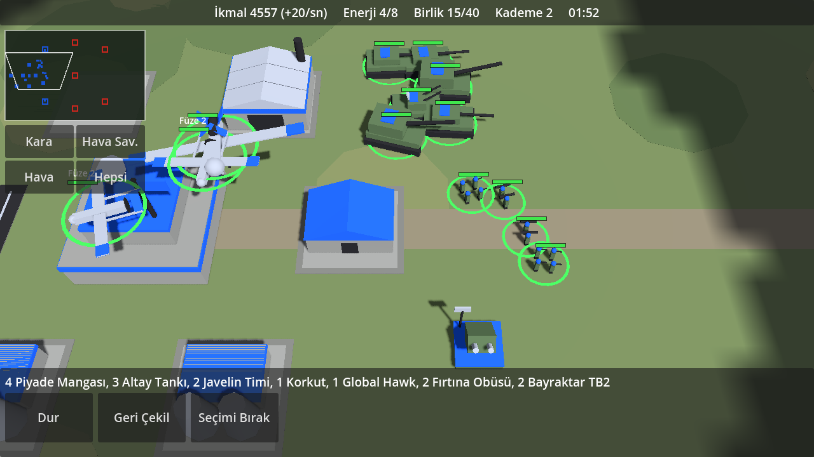

# Generals Game (çalışma adı)

Android için gerçek zamanlı strateji oyunu prototipi. Günümüz silahları, gerçek adlar, low-poly 3D.
Motor: **Godot 4.3** (GDScript, Compatibility/GLES3 işleyici).

Tasarım dokümanı: [docs/OYNANIS.md](docs/OYNANIS.md)




## Prototipte neler var

- Tek harita, yapay zekâya karşı 1'e 1 (sen Mavi, rakip Kızıl).
- Ekonomi: karargâh geliri + ele geçirilen ikmal noktaları ve ortadaki petrol tesisi.
- Üs: karargâhın çevresinde 6 hazır yuva. Santral, Kışla, Araç Fabrikası, İHA İstasyonu.
- Kademe 2 yükseltmesi; serbest yerleştirilen Hisar hava savunma.
- 7 birim: Piyade Mangası, Javelin Timi, Altay Tankı, Fırtına Obüsü, Korkut, Global Hawk, Bayraktar TB2.
- Savaş sisi: görmediğin yer hedefini vuramazsın. Fırtına 32 birim menzilden vurur ama hedefi başka bir birimin görmesi gerekir.
- İHA'lar bölgeye atanır; TB2 iki füzesini atınca istasyona dönüp silahlanır.
- Zafer: düşman karargâhını yık.

Henüz yok: insanlı uçaklar (F-16, F-35), doktrin seçimi, destek yetenekleri, ses, çok oyunculu mod, engelli arazi ve yol bulma.

## Kontroller

| Hareket | Sonuç |
|---|---|
| Dokun | Birim / bina / boş yuva seç. Birim seçiliyken: yere dokun = saldırarak ilerle, düşmana dokun = saldır |
| Çift dokun | Ekrandaki aynı tip birimlerin hepsini seç |
| Sürükle | Kamerayı kaydır |
| Basılı tut + sürükle | Kutu seçimi |
| İki parmak | Yakınlaştır / uzaklaştır (bilgisayarda fare tekerleği) |
| Küçük harita | Dokunduğun yere kamerayı götürür |
| Kara / Hava Sav. / Hava / Hepsi | O gruptaki bütün birimleri seçer |
| Geri Çekil | Seçili birimler ateş etmeden üsse döner |

## Çalıştırma

1. [Godot 4.3](https://godotengine.org/download/archive/4.3-stable/) indir.
2. Godot'u aç, **Import** ile bu klasördeki `project.godot` dosyasını seç.
3. **F5** ile oyna. Fare dokunmatik gibi çalışır.

### Android APK

Godot'ta **Editor → Manage Export Templates** ile şablonları indir, **Editor Settings → Export → Android**
altında Android SDK ve Java yolunu göster, sonra **Project → Export → Android → Export Project**.
Dışa aktarma ayarı (`export_presets.cfg`) repoda hazırdır.

## Dosya düzeni

| Yol | İçerik |
|---|---|
| `scripts/defs.gd` | **Bütün sayılar ve adlar**: birim/bina değerleri, maliyetler, harita noktaları. Denge buradan ayarlanır |
| `scripts/game.gd` | Ana döngü, ekonomi, seçim, emirler, efektler |
| `scripts/unit.gd`, `air_unit.gd`, `building.gd`, `entity.gd` | Kara birimi, İHA, bina ve ortak taban |
| `scripts/models.gd` | Kodla üretilen low-poly modeller |
| `scripts/fog.gd` | Savaş sisi |
| `scripts/controls.gd`, `camera_rig.gd` | Dokunmatik kontroller ve kamera |
| `scripts/hud.gd` | Arayüz |
| `scripts/ai.gd` | Yapay zekâ rakip |
| `tools/` | Geliştirme testleri |

## Testler

```bash
godot --headless --path . --import
```

```bash
godot --headless --path . --fixed-fps 30 -- --autotest
```

```bash
godot --path . -- --inputtest
```

`--autotest` senaryolu bir maç oynatır (ekran görüntüsü için `--shots=KLASÖR` ekle ve `--headless` kullanma).
`--inputtest` dokunma hareketlerini taklit edip kontrolleri doğrular; gerçek pencere ister.
