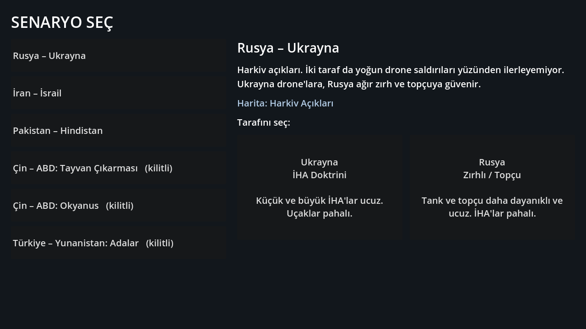
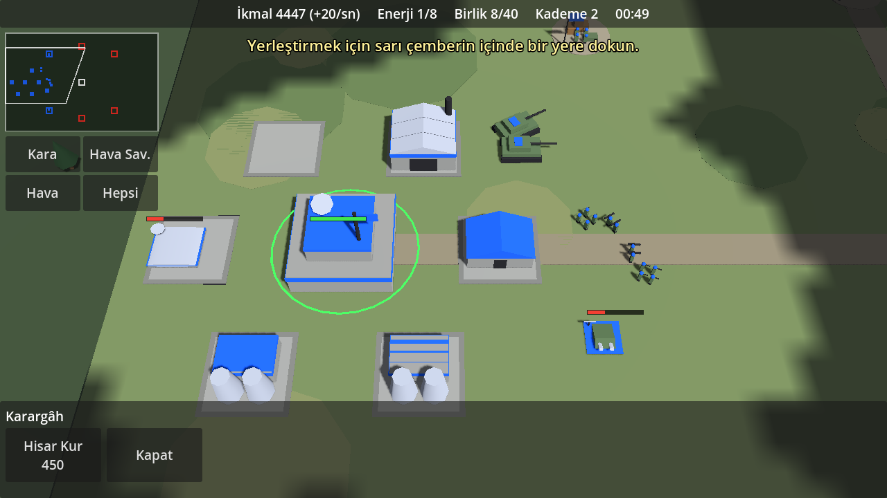
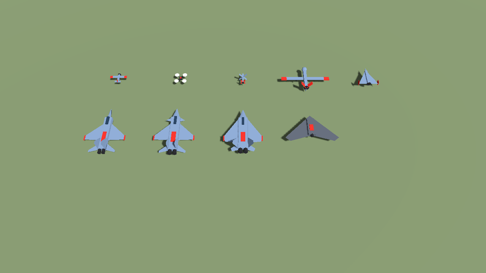

# Generals Game (çalışma adı)

Android için gerçek zamanlı strateji oyunu prototipi. Günümüz silahları, gerçek adlar, low-poly 3D.
Motor: **Godot 4.3** (GDScript, Compatibility/GLES3 işleyici).

Tasarım dokümanı: [docs/TASARIM.md](docs/TASARIM.md) (hedef ve yol haritası)







## Şu an oynanabilen

**Senaryolar.** Açılışta senaryo ve taraf seçilir; her senaryoda iki tarafı da oynayabilirsin.

| Senaryo | Taraflar ve doktrinleri | Harita |
|---|---|---|
| Rusya – Ukrayna | Ukrayna (İHA) / Rusya (Zırhlı-Topçu) | Harkiv açıkları: tarlalar, ağaç hatları, yıkık köy |
| İran – İsrail | İsrail (Hava Üstünlüğü) / İran (Balistik Füze) | Körfez: çöl, dağ sıraları, güneyde deniz |
| Pakistan – Hindistan | Pakistan (Balistik Füze) / Hindistan (Dengeli) | Sınır hattı: dağlık kuzey, nehir ve köprüler |
| Çin – ABD (2 senaryo), Türkiye – Yunanistan | kilitli | deniz moduyla açılacak |

**Ülkeler kendi silahlarını kullanır** (her ülkede 16-18 birim). Örnekler: T-64BV, Leopard 2A6, T-90M, Merkava Mk 4,
Karrar, Al-Khalid, Arjun; F-16, Mirage 2000, Su-35, Su-34, Su-57, F-35I, F-15I, F-14A, MiG-29, JF-17, J-10C, Rafale,
Su-30MKI, Tejas; Bayraktar TB2, Akıncı, Shahed-136, Geran-2, Lancet-3, Harop, Mohajer-6, MQ-9B; HIMARS, TOS-1A,
Pinaka; Patriot, S-400, Iron Dome, Bavar-373.

**Birim sınıfları**
- Kara: piyade, tanksavar timi, hafif zırhlı araç, tank, obüs, çok namlulu roketatar, hareketli hava savunma.
- Küçük İHA (kışladan, elden atılır): keşif dronu, FPV kamikaze (3'lü paket, uçuş süresi sınırlı), bombardıman dronu, dolanan mühimmat.
- Büyük İHA (hava alanı gerekir): keşif, silahlı, ağır silahlı, uzun menzilli kamikaze.
- Uçak (hava alanı gerekir, alan başına 4 pist): çok amaçlı, taarruz, görünmez. Görünmez uçağı hava savunma ancak yakından görür.

**Binalar:** Karargâh, Santral, Maden Ocağı (para), Kışla, Fabrika, Hava Alanı, hava savunma (ülkeye göre adı değişir),
Teknoloji Merkezi (6 araştırma, Kademe 3 için şart), Füze Üssü.

**Füzeler:** Füze Üssü'nden füze seçilir, haritada **görebildiğin** bir yere dokunulur. Menzildeki düşman hava savunması
füzeyi önleyebilir; hipersonik füzeler (Fattah-2, BrahMos, Fatah-IV) önlenemez.

**Doktrinler** maliyet ve dayanıklılığı değiştirir: örneğin İHA doktrininde dronlar ucuz, uçaklar pahalıdır; Balistik Füze
doktrininde füzeler ucuzdur ve Füze Üssü bir kademe erken açılır.

**Deneysel silahlar (Kademe 3):** Tryzub ve Iron Beam lazerleri (drone katili), S-70 Okhotnik-B, Ghatak, Su-57, F-35I, hipersonik füzeler.

Ayrıca: arazi ve yol bulma, serbest bina yerleşimi, vinç, hız düğmesi (duraklatıp emir verme), karargâh yanında onarım, savaş sisi.

Henüz yok: deniz modu ve kilitli senaryolar, ses, zorluk seçimi, engebeli arazide görüş avantajı.

## Kontroller

| Hareket | Sonuç |
|---|---|
| Dokun | Birim / bina seç. Birim seçiliyken: yere dokun = saldırarak ilerle, düşmana dokun = saldır. Hava aracında: o bölgede devriye |
| Çift dokun | Ekrandaki aynı tip birimlerin hepsini seç |
| Sürükle | Kamerayı kaydır |
| Basılı tut + sürükle | Kutu seçimi |
| İki parmak | Yakınlaştır / uzaklaştır (bilgisayarda fare tekerleği) |
| Küçük harita | Dokunduğun yere kamerayı götürür |
| Kara / Hava Sav. / Hava / Hepsi | O gruptaki bütün birimleri seçer |
| İnşa | Bina menüsünü açar; bina seç, sonra haritada yerini göster. Vinç ve Kademe de burada |
| Hız | Normal / Yavaş / Duraklat |
| Geri Çekil | Seçili birimler ateş etmeden üsse döner |

## Çalıştırma

1. [Godot 4.3](https://godotengine.org/download/archive/4.3-stable/) indir.
2. Godot'u aç, **Import** ile bu klasördeki `project.godot` dosyasını seç.
3. **F5** ile oyna. Fare dokunmatik gibi çalışır.

### Android APK

Godot'ta **Editor → Manage Export Templates** ile şablonları indir, **Editor Settings → Export → Android**
altında Android SDK ve Java yolunu göster, sonra **Project → Export → Android → Export Project**.
Dışa aktarma ayarı (`export_presets.cfg`) repoda hazırdır.

## Dosya düzeni

| Yol | İçerik |
|---|---|
| `scripts/scenarios.gd` | **Oyunun verisi**: birim sınıfları, ülkeler ve envanterleri, doktrinler, araştırmalar, haritalar, senaryolar. Denge buradan ayarlanır |
| `scripts/defs.gd` | Genel sabitler (başlangıç parası, kademe bedelleri, yapay zekâ zorluğu) |
| `scripts/game.gd` | Maç döngüsü, ekonomi, inşa, araştırma, füzeler, seçim, emirler, efektler |
| `scripts/unit.gd`, `air_unit.gd`, `building.gd`, `entity.gd`, `shot.gd` | Kara birimi, hava aracı, bina, ortak taban, mermi |
| `scripts/models.gd` | Kodla üretilen low-poly modeller; uçak ölçüleri `JETS` tablosunda |
| `scripts/terrain.gd` | Arazi ve yol bulma |
| `scripts/fog.gd` | Savaş sisi |
| `scripts/controls.gd`, `camera_rig.gd` | Dokunmatik kontroller ve kamera |
| `scripts/hud.gd`, `menu.gd` | Oyun içi arayüz ve senaryo seçim ekranı |
| `scripts/ai.gd` | Yapay zekâ rakip |
| `tools/` | Geliştirme testleri |

## Testler

```bash
godot --headless --path . --import
```

```bash
godot --headless --path . --fixed-fps 30 -- --autotest --scn=0 --side=0
```

```bash
godot --path . -- --inputtest --scn=2
```

```bash
godot --path . -- --gallery --scn=0 --shots=KLASÖR
```

- `--autotest`: oyuncu yerine bir bot oynar; her binayı kurar, her birimi üretir, araştırma yapar, füze atar ve saldırır.
  `--scn` senaryoyu (0-2), `--side` tarafı (0-1) seçer. Ekran görüntüsü için `--headless` olmadan `--shots=KLASÖR` ekle.
- `--inputtest`: dokunma hareketlerini taklit edip kontrolleri ve kuralları doğrular; gerçek pencere ister.
- `--gallery`: senaryodaki bütün modelleri yan yana dizip görüntüsünü alır.
