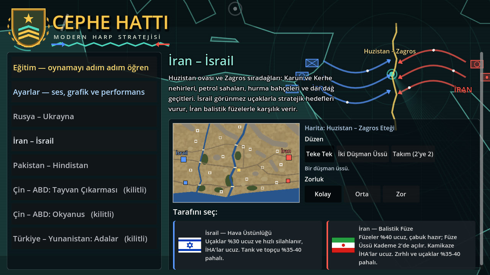
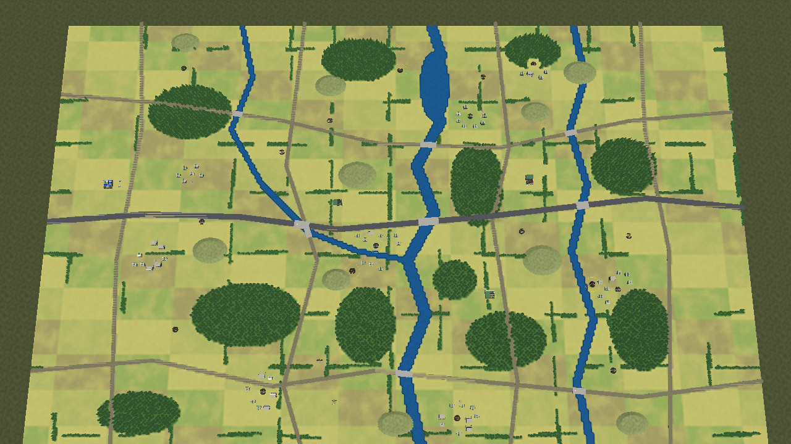
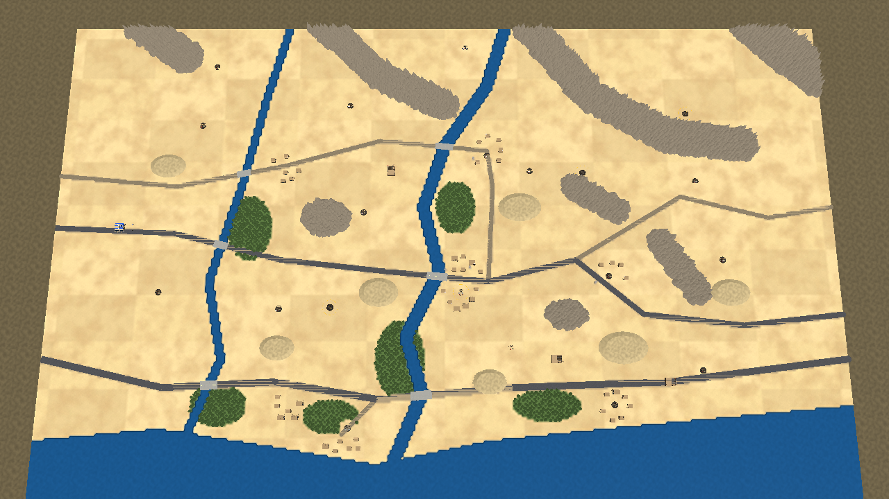
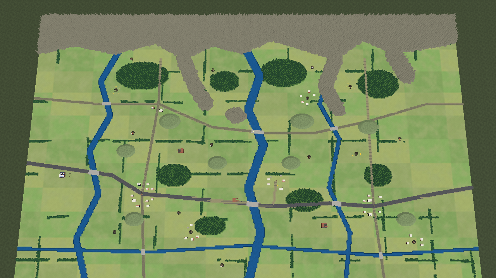
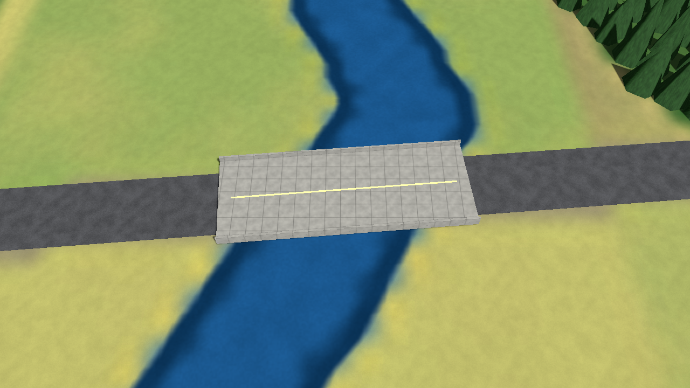
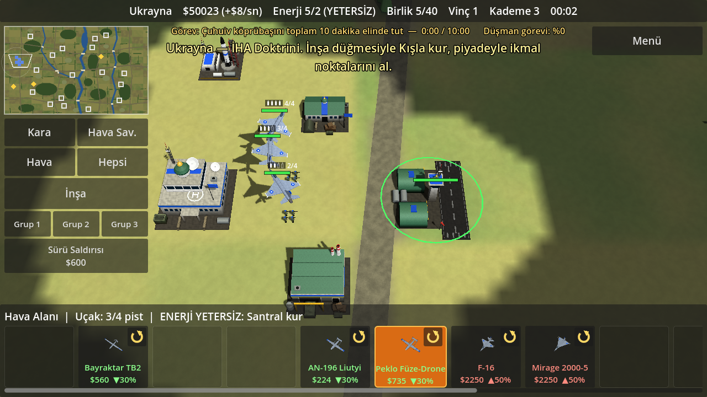
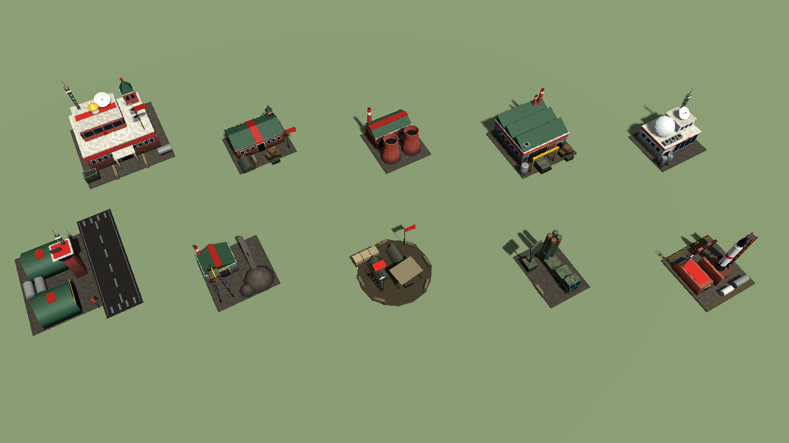
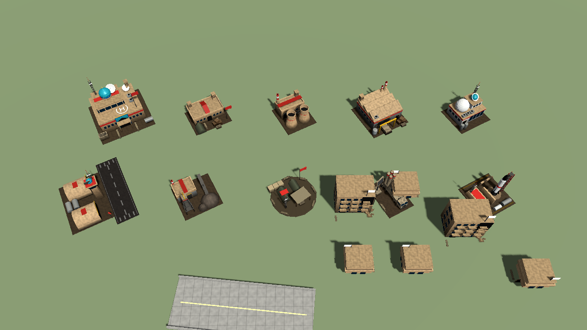
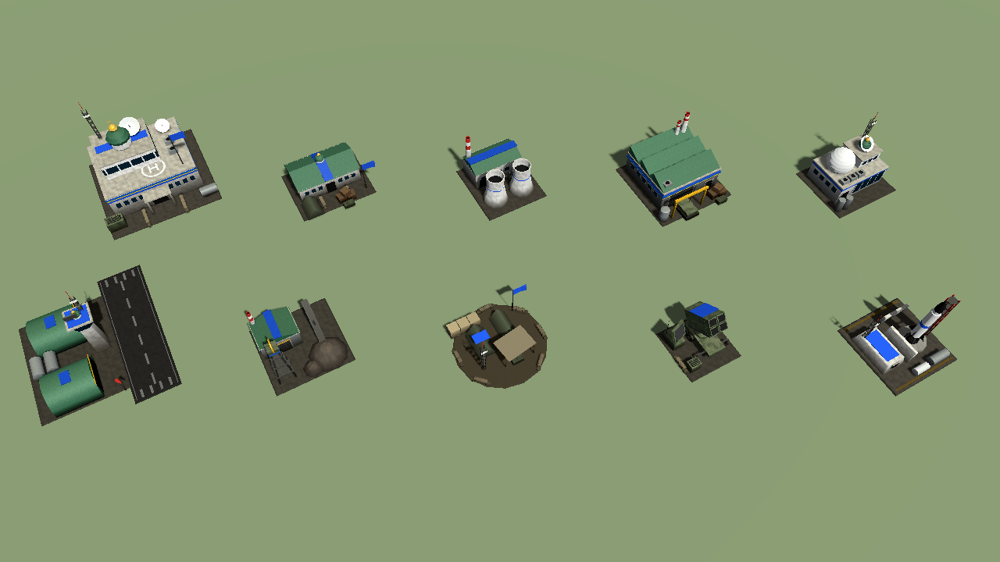
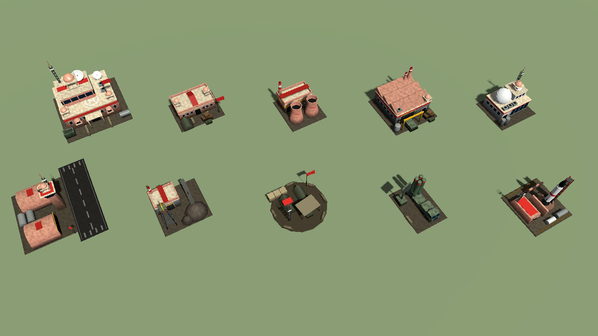

# Generals Game (çalışma adı)

Android için gerçek zamanlı strateji oyunu prototipi. Günümüz silahları, gerçek adlar, low-poly 3D.
Motor: **Godot 4.3** (GDScript, Compatibility/GLES3 işleyici).

Tasarım dokümanı: [docs/TASARIM.md](docs/TASARIM.md) (hedef ve yol haritası)

Logo ve menüdeki oyun adı ("CEPHE HATTI") bir öneridir; `scripts/logo.gd` içindeki `TITLE` sabitinden değiştirilir.























## Şu an oynanabilen

**Senaryolar.** Açılışta senaryo, taraf, zorluk ve maç düzeni seçilir; her senaryoda iki tarafı da oynayabilirsin.
Menünün arkasında taktik bir dünya haritası vardır: senaryo seçilince harita o bölgeye yaklaşır, renk teması değişir,
iki tarafın birlik simgeleri ve cephe okları çizilir; yanda savaş alanının gerçek önizlemesi görünür.

| Senaryo | Taraflar ve doktrinleri | Harita (720 x 440) |
|---|---|---|
| Rusya – Ukrayna | Ukrayna (İHA) / Rusya (Zırhlı-Topçu) | Harkiv – Severski Donets: Donets, Oskil ve Udy nehirleri, Peçenihi barajı, köprüler, geniş ormanlar, ağaç hatlarıyla bölünmüş tarlalar, Çuhuiv, Kupiansk, İzyum, Vovçansk |
| İran – İsrail | İsrail (Hava Üstünlüğü) / İran (Balistik Füze) | Huzistan – Zagros: Karun ve Kerhe nehirleri, Basra Körfezi kıyısı, Zagros sıradağları ve geçitleri, hurma bahçeleri, Ahvaz ve Abadan petrol tesisleri |
| Pakistan – Hindistan | Pakistan (Balistik Füze) / Hindistan (Dengeli) | Keşmir – Kontrol Hattı: Himalaya etekleri, çam ormanları, hâkim tepeler, Chenab, Jhelum ve Tawi nehirleri, Pencap kanalları |
| Çin – ABD (2 senaryo), Türkiye – Yunanistan | kilitli | deniz moduyla açılacak |

**Maç düzeni:** Teke Tek; İki Düşman Üssü (düşmanın iki ayrı üssü ve ordusu); Takım 2'ye 2 (yanında müttefik bir yapay
zekâ ordusu, karşında iki düşman üssü). Aynı taraftakiler görüşü ve görevi paylaşır. Düşman tarafının bütün
karargâhları yıkılınca ya da görev tamamlanınca maç biter.

**Büyük haritalar ve lojistik.** Haritalar eskisinin 10 katı alan kaplar. Birlikler uzun yol yürür; yol bulma yolları
tercih eder (yolda %50 hızlı). **İkmal hattı:** karargâh (75), İleri Harekât Üssü (55) ve sağlam ikmal noktaları (40)
çevresine ikmal sağlar. Hattın dışındaki kara birliği %30 az hasar verir, %10 yavaş gider ve onarılmaz (üstünde turuncu
işaret çıkar). İleri Harekât Üssü birliklerinin yanında her yere kurulur, birlikleri onarır ve çevresine kışla, santral
ve hava savunma kurulabilir.

**Taktik arazi.** Köprüler yıkılabilir (topçu, füze, uçak ya da "Köprü Yık" emri); yıkılan köprünün üstündekiler suya
düşer, nehir orada geçilmez olur. Yıkık köprü, yanında yalnızca bir tarafın askerî birlikleri bulunduğu sürece 40 saniyede
onarılır. Tepeyi tutmak: görüş %30, menzil %15 ve hasar %15 artar; tepedeki atıcı ağaçların ve yıkıntıların üstünden
görür. Geniş ormanlar ve ağaç hatları piyadeyi her zaman, aracı dururken gizler (yalnızca yakından görülür), derin orman
görüşü keser. Kasabalarda köy evleri (2 birlik), yıkık apartmanlar (3 birlik, üst kattan uzağı görür) ve terk edilmiş
fabrikalar (4 birlik) vardır.

**Kaynaklar.** Gelir çok düşüktür: karargâh $8/sn, ikmal noktası $2, kasaba $3, petrol/gaz $4-6. Maç boyunca haritanın
rastgele yerlerinde **kaynak yatakları** belirir ve herkese duyurulur (küçük haritada yanıp söner). Yatağın üstüne
Maden Ocağı ilk kuran takımın olur ($5,5-9/sn; kurulumu $1600, yanında kendi birliğin olmalı); yatağın rezervi bitince
tükenir. **Bütün kaynaklar tahrip edilebilir:** ikmal noktaları ve madenler hasar aldıkça daha az gelir getirir, sıfıra
inen nokta kimsesiz kalır. Onarım yalnızca yanlarında kendi tarafının askerî birliği varken ve çevrede düşman yokken ilerler.

**Doktrinler** fiyatı belirler: doktrine uyan birimler %25-40 ucuz, uymayanlar %20-60 pahalıdır (kartta yeşil ▼ ya da
kırmızı ▲). Bazı ülkelerde bazı birimler hiç yoktur: Ukrayna'nın tankı yoktur (İHA'larla Rus zırhını avlar), İsrail'in
çok namlulu roketatarı, İran'ın taarruz uçağı yoktur. Üretim panelinde birimler sabit yuvalara dizilir; ülkede olmayan
birimin yuvası boş kalır, diğerleri kaymaz.

**Deneysel silahlar (Kademe 3)** turuncu kartla gösterilir; %50 pahalı, %50 daha çok hasar ve %30 daha çok can:
T-14 Armata, Merkava Barak, Su-57, S-70, F-35I, J-35, Ghatak, Peklo füze-drone, Shahed-238, Tryzub, Iron Beam ve DURGA-II
lazerleri, hipersonik füzeler.

**Ulusal mimari.** Her ülkenin binaları kendi üslubundadır: Ukrayna'da badanalı duvar, yeşil çatı ve altın armut kubbe;
Rusya'da kızıl tuğla, çadır çatılı kule, soğan kubbe ve kızıl yıldız; İsrail'de Kudüs taşı, kemerli revak ve çatıda güneş
enerjili su ısıtıcıları; İran'da kerpiç, turkuaz kubbe, rüzgâr kuleleri (badgir) ve çinili eyvan; Pakistan'da kızıl kumtaşı,
beyaz mermer Babür kubbesi ve çhatriler; Hindistan'da pembe kumtaşı, çhatriler ve cumbalı pencereler. Köy evleri
haritanın üslubunu alır.

**Hava araçlarının mühimmatı:** her silahlı uçak ve İHA'nın üstünde dolu ve boş füzeleri simge olarak görünür
(dost birimlerde "3/4" sayısı da yazar); silahlanırken "silahlanıyor" yazar.

**Ülkeler kendi silahlarını kullanır** (her ülkede 16-20 birim). Örnekler: T-72B3, T-90M, T-14 Armata, Merkava Mk 4,
Karrar, Al-Khalid, Arjun; F-16, Mirage 2000, Su-35, Su-34, Su-57, F-35I, F-15I, F-14A, MiG-29, JF-17, J-10C, Rafale,
Su-30MKI, Tejas; Bayraktar TB2, Akıncı, Shahed-136, Geran-2, Lancet-3, Harop, Mohajer-6, MQ-9B; HIMARS, TOS-1A,
Pinaka; Patriot, S-400, Iron Dome, Bavar-373.

**Birim sınıfları**
- Kara: piyade, tanksavar timi, hafif zırhlı araç, tank, obüs, çok namlulu roketatar, hareketli hava savunma.
- Küçük İHA (kışladan, elden atılır): keşif dronu, FPV kamikaze (3'lü paket, uçuş süresi sınırlı), bombardıman dronu, dolanan mühimmat.
- Büyük İHA (hava alanı gerekir): keşif, silahlı, ağır silahlı, uzun menzilli kamikaze.
- Uçak (hava alanı gerekir, alan başına 4 pist): çok amaçlı, taarruz, görünmez. Görünmez uçağı hava savunma ancak yakından görür.

**Binalar:** Karargâh, Santral, Kışla, Fabrika, Maden Ocağı (yalnızca kaynak yatağına), İleri Harekât Üssü, Hava Alanı,
hava savunma (ülkeye göre adı değişir), Teknoloji Merkezi (7 araştırma, Kademe 3 için şart), Füze Üssü.

**Füzeler:** Füze Üssü'nden füze seçilir, haritada **görebildiğin** bir yere dokunulur. Menzildeki düşman hava savunması
füzeyi önleyebilir; hipersonik füzeler (Fattah-2, BrahMos, Fatah-IV) önlenemez.

**Animasyonlar:** tank ve zırhlıların kulesi gövdeden bağımsız hedefe döner; ateşte geri tepme, namlu alevi ve duman;
araçların arkasında toz; piyade yürürken adım atar, ateş ederken çömelir; füzeler duman izi bırakır; vurulan uçak
duman bırakarak düşer; yok edilen birimlerin yerinde yanık izi kalır.

**Elektronik harp:** her ülkenin EH aracı (Bukovel-AD, Silok, Drone Dome, Kobra V8, D4) çevresindeki küçük dronları
düşürür, büyük İHA'ların kilidini bozar. "Fiber Optik FPV" araştırmasıyla FPV'ler etkilenmez.

**Siper ve mevzi:** piyade siper kazar (yarı hasar), köy evlerine girer (%60 az hasar, daha uzun menzil),
tanksavar mayını döşer (araçlar tetikler, düşman yalnızca yakından görür) ve tanksavar engeli kurar (yolu kapatır).

**Tecrübe ve geri çekilme:** hasar veren birimler rütbe kazanır (Er → Çavuş → Kıdemli → Gazi; her rütbe daha çok hasar,
daha az kayıp). Geri çekilen birlik %25 hızlı gider ve %30 az hasar alır; karargâh yanında onarılır.

**Doktrin yetenekleri:** Sürü Saldırısı (İHA), Havada Yakıt İkmali (Hava Üstünlüğü), Topçu Barajı (Zırhlı/Topçu),
Doyurma Salvosu (Balistik Füze), Seferberlik (Dengeli).

**Görev hedefleri:** karargâhı yıkmanın yanında her tarafın kendi görevi var: Rusya – Ukrayna'da Çuhuiv köprübaşını
10 dakika tutmak; İsrail'in 4 stratejik hedefi yok etmesi, İran'ın Ahvaz petrol terminalini tutması; Pakistan'ın 3 üretim
tesisini yıkması, Hindistan'ın Akhnur köprübaşını tutması. Ekranın üstünde senin ve düşmanın ilerlemesi görünür.

**Birim kartları:** üretim düğmesinin köşesindeki çevirme simgesine basınca kart arkaya döner; can, kara gücü,
hava gücü, menzil ve hız görünür, ekranın altında o birimin kullanım ipucu çıkar.

**Yapay zekâ:** her bilgisayar takımı (düşman ya da müttefik) için ayrı çalışır. Üç zorluk (Kolay, Orta, Zor) gelirini,
düşünme sıklığını, ilk saldırı zamanını ve davranışını değiştirir. Kaynak yataklarına korumalı maden kurar, madenlerine
bekçi bırakır, hasarlı kaynaklarının yanına onarım için birlik gönderir; toplanma yeri ikmal dışındaysa İleri Harekât Üssü
kurar. Ordusunu doktrinine göre kurar (ucuz sınıfları çok alır) ve gördüğüne karşılık verir: uçaklara hava savunma, zırha
tanksavar ve İHA, dron sürüsüne EH ve lazer; deneysel silah kullanır. Orta ve Zor'da düşman madenlerine ve noktalarına
baskın yapar, en zayıf savunulan hedefi seçer, odaklı ateşle en zayıf düşmanı birlikte vurur, uçaklarla önce hava
savunmasını susturur. Karşı taraf tutma görevini bitirmek üzereyse bütün ordusuyla o noktaya yürür. Yaralı birliklerini
ve çöken dalgaları geri çeker.

**Arayüz:** eğitim bölümü (10 adım); üretim binalarına toplanma
noktası (birlikler orada yayılarak durur); devriye emri; üç birlik grubu (basılı tut: kaydet, dokun: seç, iki kez: kamerayı
götür); otomatik kayıt (dakikada bir, menüye dönüşte ve uygulama arka plana geçince) ve menüde "Devam Et".

**Ses ve görsellik:** atış, top, topçu, füze, lazer, patlama, uyarı, nokta alma ve terfi sesleri ile arka plan müziği
kodla sentezlenir (ses dosyası yok); sesler kameraya uzaklığa göre kısılır. Uçaklar ve büyük İHA'lar pistten kalkar,
mühimmatı bitince piste iner, silahlanıp yeniden kalkar. Yok edilen araçlar yanmış enkaz, binalar moloz bırakır;
ağır hasarlı binalar tüter ve yanar.

**Ayarlar:** menüde ses, müzik, gölge, duman/toz efektleri ve texture'lar ayrı ayrı kapatılabilir (eski telefonlar için).

Ayrıca: arazi ve yol bulma, serbest bina yerleşimi, vinç, karargâh yanında onarım, savaş sisi.

Henüz yok: deniz modu ve kilitli senaryolar.

## Kontroller

| Hareket | Sonuç |
|---|---|
| Dokun | Birim / bina seç. Birim seçiliyken: yere dokun = saldırarak ilerle, düşmana dokun = saldır. Hava aracında: o bölgede devriye |
| Çift dokun | Ekrandaki aynı tip birimlerin hepsini seç |
| Sürükle | Kamerayı kaydır |
| Basılı tut + sürükle | Kutu seçimi |
| İki parmak | Yakınlaştır / uzaklaştır (bilgisayarda fare tekerleği) |
| Küçük harita | Dokunduğun yere kamerayı götürür |
| Kara / Hava Sav. / Hava / Hepsi | O gruptaki bütün birimleri seçer |
| İnşa | Bina menüsünü açar; bina seç, sonra haritada yerini göster. Vinç ve Kademe de burada |
| Geri Çekil | Seçili birimler ateş etmeden en yakın karargâha ya da ileri üsse döner |
| Köprü Yık | Seçili birimler dokunulan köprüye ateş eder |

## Çalıştırma

1. [Godot 4.3](https://godotengine.org/download/archive/4.3-stable/) indir.
2. Godot'u aç, **Import** ile bu klasördeki `project.godot` dosyasını seç.
3. **F5** ile oyna. Fare dokunmatik gibi çalışır.

### Android APK

Godot'ta **Editor → Manage Export Templates** ile şablonları indir, **Editor Settings → Export → Android**
altında Android SDK ve Java yolunu göster, sonra **Project → Export → Android → Export Project**.
Dışa aktarma ayarı (`export_presets.cfg`) repoda hazırdır.

## Dosya düzeni

| Yol | İçerik |
|---|---|
| `scripts/scenarios.gd` | **Oyunun verisi**: birim sınıfları, ülkeler ve envanterleri, doktrinler (fiyat çarpanları), araştırmalar, üretim yuvaları, haritalar (şekillerle), senaryolar. Denge buradan ayarlanır |
| `scripts/defs.gd` | Genel sabitler (başlangıç parası, gelir, kademe bedelleri, yapay zekâ zorluğu, maç düzenleri, lojistik ve kaynak yatağı ayarları), takım/taraf ilişkileri |
| `scripts/game.gd` | Maç döngüsü, ekonomi, inşa, araştırma, füzeler, seçim, emirler, efektler |
| `scripts/unit.gd`, `air_unit.gd`, `building.gd`, `entity.gd`, `shot.gd` | Kara birimi, hava aracı, bina, ortak taban, mermi |
| `scripts/models.gd` | Model girişi: bütün birim ve binaları ilgili dosyadan önbellekli olarak kurar; basit kutu/silindir yardımcıları |
| `scripts/tanks.gd` | Ayrıntılı tank modelleri (T-72B3, T-90M, Leopard 2A6, Merkava Mk 4): gerçek ölçülerle yürüyen aksam, kule, reaktif zırh, takım rengi tanıma örtüsü |
| `scripts/vehicles.gd` | Diğer kara araçları ve piyade: BMP, M113 türevleri, Bradley, Namer, Gepard, Shilka, Tor, obüsler, TOS-1A, kamyonlu sistemler (Pantsir, Iron Dome, HIMARS, roketatarlar, lazer) |
| `scripts/buildings.gd` | Bina modelleri, hava savunma bataryaları, vinç, ikmal noktaları, kaynak yatağı, ileri üs, apartman ve fabrika harabesi; ülkelere göre mimari üslup (renkler, çatı tipi, kubbe, kule, yıldız, güneş paneli, çhatri) |
| `scripts/aircraft.gd` | Ayrıntılı uçak ve İHA modelleri: jetler `AIRFRAMES` tablosundan (gövde istasyonları, hava alığı, nasel, kokpit camı, füze/bomba, milli işaret), İHA'lar gerçek ölçüyle; dönen pervaneler |
| `scripts/kit.gd` | Araç mesh kurucusu: parçaları malzeme başına tek yüzeyde birleştirir, çamur/toz/gölgeyi köşe rengine işler |
| `scripts/tex.gd` | Kodla üretilen texture'lar (arazi, su, kaya, kamuflaj, panel, boyalı zırh, metal, palet, branda, uçak boyası, beton, oluklu sac) |
| `scripts/terrain.gd` | Arazi: haritayı şekillerden kurar (nehir, yol, köprü, kasaba, tarla ağaç hatları), zemin resmi ve shader'ı, yol bulma, görüş hattı |
| `scripts/bridge.gd`, `supply_point.gd`, `deposit.gd`, `garrison.gd` | Yıkılabilir köprü; tahrip edilebilir ikmal noktası; kaynak yatağı; girilebilen ev, apartman ve fabrika |
| `scripts/logo.gd`, `world_map.gd`, `map_preview.gd` | Logo ve amblem; menünün taktik dünya haritası ve bayraklar; senaryo harita önizlemesi |
| `scripts/fog.gd` | Savaş sisi |
| `scripts/controls.gd`, `camera_rig.gd` | Dokunmatik kontroller ve kamera |
| `scripts/hud.gd`, `menu.gd` | Oyun içi arayüz ve senaryo seçim ekranı |
| `scripts/ai.gd` | Yapay zekâ (düşman ve müttefik ordular) |
| `tools/` | Geliştirme testleri |

## Testler

```bash
godot --headless --path . --import
```

```bash
godot --headless --path . --fixed-fps 30 -- --autotest --scn=0 --side=0
```

```bash
godot --path . -- --inputtest --scn=2
```

```bash
godot --path . -- --gallery --scn=0 --shots=KLASÖR
```

- `--autotest`: oyuncu yerine bir bot oynar; her binayı kurar, her birimi üretir, kaynak yatağına maden ve ileri üs kurar,
  araştırma yapar, füze atar ve saldırır. `--scn` senaryoyu (0-2), `--side` tarafı (0-1), `--mode` maç düzenini
  (0 teke tek, 1 iki düşman üssü, 2 takım) seçer; `--idle` ile oyuncu hiçbir şey yapmaz (yapay zekânın temposunu ölçer).
  Ekran görüntüsü için `--headless` olmadan `--shots=KLASÖR` ekle.
- `--inputtest`: dokunma hareketlerini taklit edip kontrolleri ve kuralları doğrular; gerçek pencere ister.
- `--gallery`: senaryodaki bütün modelleri ve iki ülkenin binalarını yan yana dizip görüntüsünü alır (`--archonly`: yalnızca binalar).
- `--mechtest --scn=0`: oynanış mekaniklerini tek tek doğrular (arazi, gizlenme, EH, siper, ev, mayın, engel, rütbe, görev,
  yetenek, kart, köprü, kaynak yatağı, maden ve nokta onarımı, ikmal hattı, ileri üs, doktrin fiyatları, boş yuvalar).
- `--load --loadtest`: `--mechtest`'in kaydettiği oyunu yükler ve durumun geri geldiğini doğrular.
- `--tutorial --tuttest`: eğitimi baştan sona oynar.
- `--maptest --scn=N`: haritanın oynanabilirliğini doğrular (her üsten her noktaya ve karşı üslere yol var mı).
- `--mapshot --scn=N --shots=KLASÖR`: haritanın üstten ve yakın görüntülerini alır; `--perfonly` ile kare sürelerini ölçer.
- `--uishot --scn=N --shots=KLASÖR`: üretim panellerinin görüntüsünü alır.
- `--diff=N`: yapay zekâ zorluğu (0 Kolay, 1 Orta, 2 Zor); `--autotest` ile birlikte kullanılabilir.
- `--duel --scn=0`: denge için aynı bütçeyle sınıf düelloları yapar ve kalan değerleri yazar.
- `--animtest`: iki küçük grubu çarpıştırır; hareket, kule dönüşü ve geri tepmeyi doğrular (`--shots=KLASÖR` ile görüntü alır).
- Menü görüntüsü: `godot --path . -- --scn=N --menushot=DOSYA.png`.
